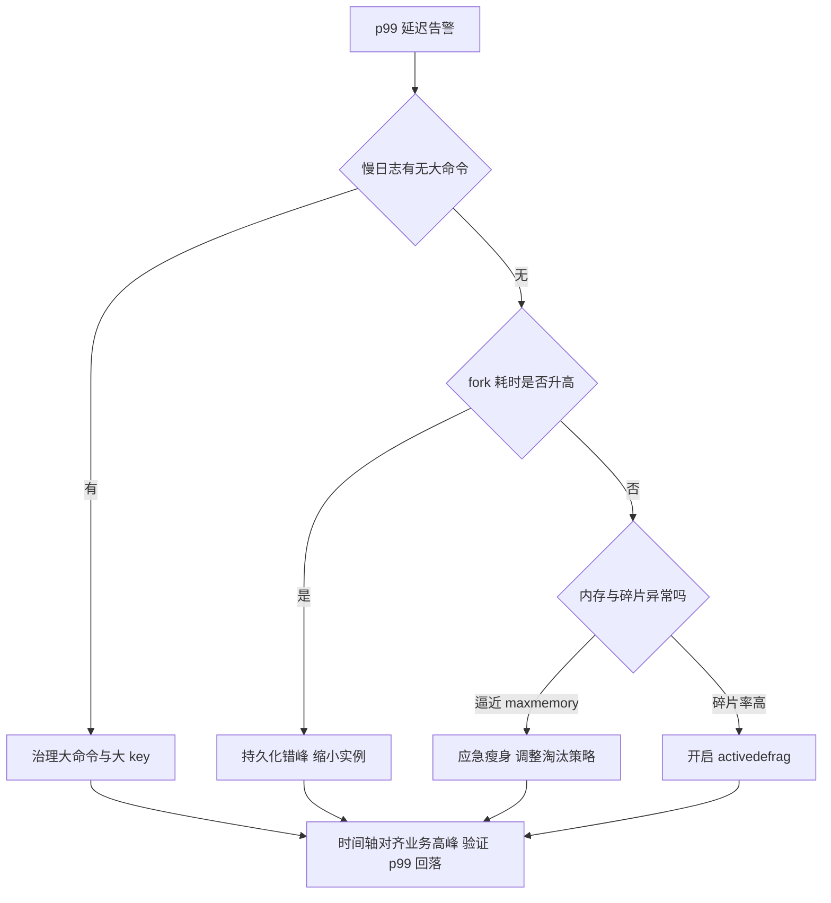

### Q1425 · 综合案例: 一次 Redis 延迟毛刺的排查链

> 难度:★★★★★ | 标签:Redis, 综合案例

**问**:线上 Redis 的 p99 从 2ms 飙到 45ms,慢日志却干净,给出你的完整排查链与结论。

**答**:排查按"应用 → 命令 → Redis 内部 → 系统层"四层递进:先看慢日志排除大命令(Q1001);再看 INFO 的 latest_fork_usec——本案例它飙到 380ms,说明 bgsave/AOF rewrite 的 fork 正在发生;接着看内存——used_memory 30GB、maxmemory 34GB、碎片率 1.6,内存逼近上限使 COW 空间紧张;最后对时间轴发现 RDB 定时任务恰好与业务高峰重叠,业务写入又触发大量 COW。结论:高峰期 fork + COW + 高碎片三因素叠加。处置:持久化错峰到低峰、开启 activedefrag、淘汰冷 key 释放 3GB、大 key 拆分;一周后 p99 回到 3ms。方法论:延迟毛刺的答案常常不在"哪条命令慢",而在"哪个后台动作与业务撞车",时间轴对齐是破案关键。

```python
# file: code/04_数据库与缓存/q1425_latency_case.py
"""综合案例: 一次 Redis 延迟毛刺的排查链"""
timeline = [
    ("10:02", "p99 从 2ms 飙到 45ms", "先看慢日志: 无超 10ms 命令 -> 排除大命令"),
    ("10:05", "INFO: latest_fork_usec=380000", "fork 耗时 380ms -> bgsave / AOF rewrite 嫌疑"),
    ("10:06", "used_memory 30GB, 碎片率 1.6", "内存逼近 maxmemory, COW 空间紧张"),
    ("10:08", "rdb_bgsave_in_progress=1 与业务高峰重叠", "定位: 高峰期 fork 加 COW 加高碎片"),
    ("10:15", "持久化错峰 + activedefrag + 淘汰冷 key", "p99 回落 3ms"),
]
for t, fact, verdict in timeline:
    print(f"[{t}] {fact}")
    print(f"      -> {verdict}")
print("复盘: 排查链 = 慢日志 -> fork 指标 -> 内存与碎片 -> 持久化时点 -> 系统层")
```

**追问**:
- 怎么提前发现而不是等告警?——把 latest_fork_usec、碎片率、内存水位、bgsave 时段做成看板并设阈值告警,持久化计划与业务高峰表放在一起管理。
- 排查为什么从慢日志开始?——先排除"单条命令慢"这个最大众的原因,取证据成本最低;干净了才升级到 fork、内存、系统层,避免一上来怀疑 OS。
- 时间轴对齐为什么是破案关键?——毛刺常是后台动作(持久化、过期、主从)与业务高峰撞车的产物,单点指标各自"正常",对齐时刻才看得出因果。
- 生产陷阱?——每次靠救火排查,复盘不入库;把排查链沉淀成 runbook 与看板阈值,同类告警按剧本十分钟定位。

---


