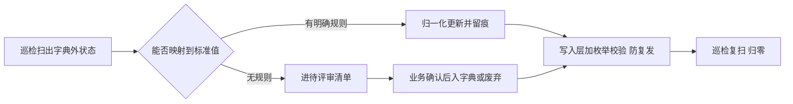

### Q1430 · 字典表一致性: 脏状态值的检测与归一

> 难度:★★☆☆ | 标签:数据质量, 字典

**问**:orders 表里 status 出现了 'paid'、'ok' 这些字典外的值,怎么治?

**答**:先查根因:字典外值的来源通常是三条——写入路径绕过了校验(直接 SQL 改数、旧代码、脚本)、大小写或全半角差异(应用没归一就落库)、以及业务语义变更没同步字典。治理闭环四步:检测——NOT IN 白名单的反连接扫出全部脏值;归因——脏值聚类,每个值问一句"它想表达什么";归一——有明确映射规则的用映射表批量 UPDATE,无规则的新值先评审、确认后正式入字典,再更新业务代码;防复发——写入层加枚举校验(Q959 的状态机),字典表加只读权限,巡检规则(Q1429)把"字典外状态"常态化监控。原则:宁可暂时把新值标为 UNKNOWN 人工审,也不要让自由文本混进状态列。

```python
# file: code/04_数据库与缓存/q1430_dict_consistency.py
"""字典表一致性: 状态值白名单校验与脏值归一"""
import sqlite3

conn = sqlite3.connect(":memory:", isolation_level=None)
conn.execute("CREATE TABLE dict_status(code TEXT PRIMARY KEY)")
conn.executescript("INSERT INTO dict_status VALUES('PAID'),('PENDING'),('FAILED')")
conn.execute("CREATE TABLE orders(id INTEGER PRIMARY KEY, status TEXT)")
conn.executemany("INSERT INTO orders VALUES(?,?)",
                 [(1, 'PAID'), (2, 'paid'), (3, 'ok'), (4, 'PENDING')])

bad = conn.execute("SELECT id, status FROM orders WHERE status NOT IN "
                   "(SELECT code FROM dict_status)").fetchall()
print("字典外状态:", bad)
mapping = {"paid": "PAID", "ok": "FAILED"}    # 归一规则, 新值需先评审入字典
for oid, s in bad:
    conn.execute("UPDATE orders SET status=? WHERE id=?",
                 (mapping.get(s, "FAILED"), oid))
left = conn.execute("SELECT COUNT(*) FROM orders WHERE status NOT IN "
                    "(SELECT code FROM dict_status)").fetchone()[0]
print(f"归一后残留 {left} 条; 防复发: 写入层枚举校验 + 巡检常态监控")
```

**追问**:
- 为什么不直接把 'paid' 也加进字典图省事?——两个语义相同的合法值会让所有查询、报表、状态机都要处理等价类,长期成本远高于一次归一。
- 归一化 UPDATE 也要分批留痕吗?——要,批量改状态会触发下游 binlog 消费与缓存失效,一次改几十万行等于自造事故;映射表留痕让归一可审计可回滚。
- 大小写脏值的根源在哪层?——写入边界没做 normalize(trim/大小写折叠),各语言客户端各传各的;归一必须固定在入库边界,事后清洗只是补课。
- 生产陷阱?——"临时"映射表变成永久依赖,字典与映射两处维护;收敛到一处管理,写入层枚举校验是最终防线。

---


