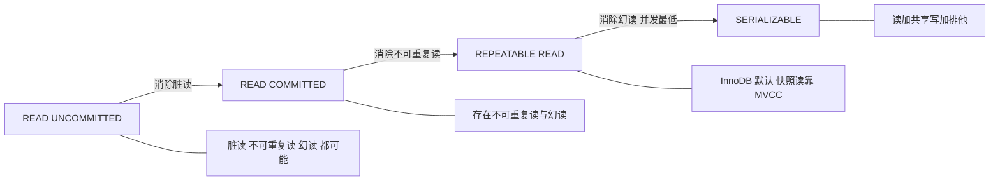

### Q147 · 四种隔离级别与并发现象

> 难度:★★★★ | 标签:MySQL, 事务, 隔离级别

**问**:SQL 标准定义了哪四种隔离级别?分别会出现什么读现象?InnoDB 默认是哪一种?

**答**:从低到高是 READ UNCOMMITTED、READ COMMITTED、REPEATABLE READ、SERIALIZABLE。现象上:RU 会出现脏读;RC 消除脏读但存在不可重复读与幻读;RR 消除不可重复读,InnoDB 通过 MVCC + 间隙锁在 RR 下基本杜绝幻读,这也是 MySQL 的默认级别;SERIALIZABLE 完全串行化,并发最低。



```python
# file: code/04_数据库与缓存/q147_isolation_levels.py
"""纯逻辑模拟三种读现象, 帮助面试时口头推演"""
from dataclasses import dataclass, field


@dataclass
class Database:
    committed: dict = field(default_factory=dict)   # 已提交数据
    uncommitted: dict = field(default_factory=dict)  # 未提交数据

    def write(self, key: str, value: int) -> None:
        self.uncommitted[key] = value

    def commit(self) -> None:
        self.committed.update(self.uncommitted)
        self.uncommitted.clear()

    def rollback(self) -> None:
        self.uncommitted.clear()


def dirty_read(db: Database, key: str) -> int:
    """READ UNCOMMITTED: 读到别人未提交的值"""
    return db.uncommitted.get(key, db.committed.get(key, 0))


def committed_read(db: Database, key: str) -> int:
    """READ COMMITTED: 每次读最新已提交值 -> 两次读可能不同即不可重复读"""
    return db.committed.get(key, 0)


if __name__ == "__main__":
    db = Database(committed={"x": 100})
    db.write("x", 999)                      # 事务 A 修改但未提交
    print("RU 视角读到:", dirty_read(db, "x"))      # 999 脏读
    db.rollback()                           # A 回滚
    print("回滚后 RC 第一次读:", committed_read(db, "x"))  # 100
    db.write("x", 200)
    db.commit()                             # B 提交了新值
    print("RC 第二次读:", committed_read(db, "x"))        # 200 不可重复读
```

**追问**:
- RC 和 RR 在 MVCC 上的区别?——RC 每条 SELECT 都生成新的 ReadView,RR 只在事务第一次快照读时生成并复用。
- Oracle/PostgreSQL 默认是什么?——都是 READ COMMITTED,和 MySQL 不同,跨库要留意。

---
