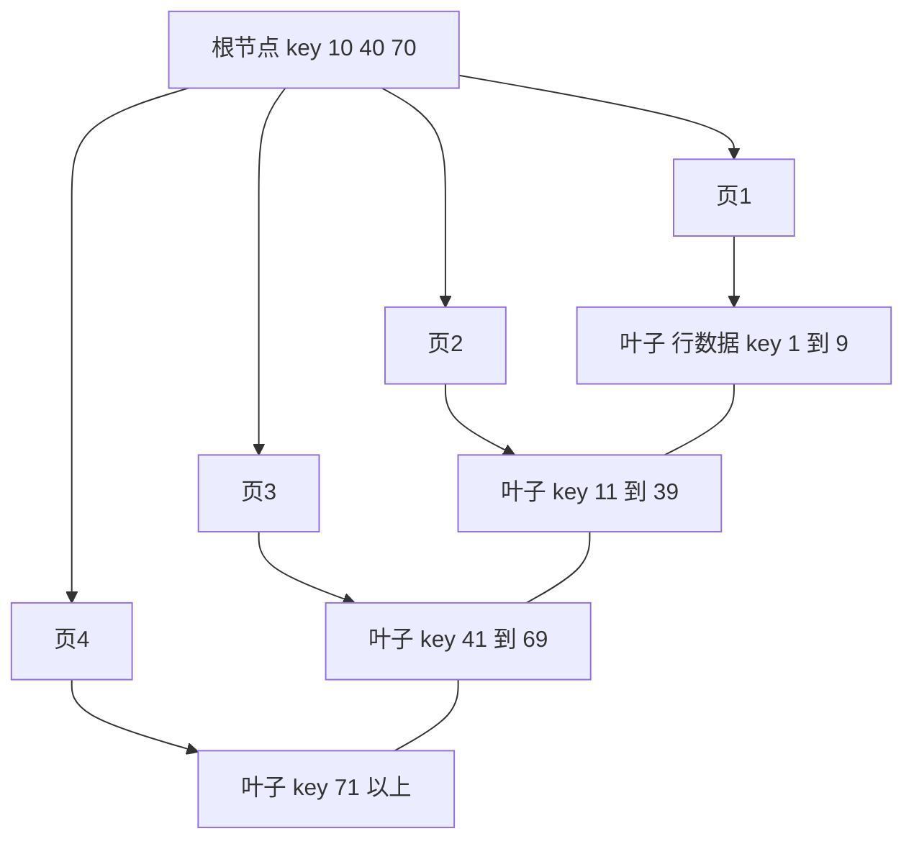

### Q150 · 为什么用 B+Tree 做索引

> 难度:★★★★ | 标签:MySQL, 索引

**问**:InnoDB 为什么选 B+Tree 而不是哈希表、红黑树或 B-Tree?

**答**:哈希表只支持等值查询不支持范围;红黑树/跳表是二叉或对数扇出,数据量大时树太高,磁盘 IO 次数多;B-Tree 数据存在所有节点,单节点能放的 key 更少。B+Tree 非叶子节点只存 key、叶子存数据,扇出极大(千万级数据通常 3~4 层),叶子节点按序双向链表相连,范围查询与排序天然高效,且树高稳定查询性能可预期。



```python
# file: code/04_数据库与缓存/q150_btree_demo.py
"""简化两级 B+Tree: 演示根节点路由到叶子与叶子链表范围扫描"""
from bisect import bisect_right
from dataclasses import dataclass, field
from typing import Optional


@dataclass
class Leaf:
    keys: list = field(default_factory=list)
    values: list = field(default_factory=list)
    next: Optional["Leaf"] = None  # 模拟叶子间的双向链表

    def range_scan(self, lo, hi):
        """叶子链表上的范围扫描: 索引高效支持 BETWEEN / ORDER BY 的原因"""
        out, node, i = [], self, bisect_right(self.keys, lo) - 1
        while node:
            while i < len(node.keys) and node.keys[i] < hi:
                out.append((node.keys[i], node.values[i]))
                i += 1
            node, i = node.next, 0
        return out


@dataclass
class Branch:
    """非叶子节点: 只存分隔 key 与子节点指针"""
    separators: list                # 例: [11, 41, 71]
    children: list

    def find_leaf(self, key) -> Leaf:
        idx = bisect_right(self.separators, key)
        child = self.children[idx]
        return child.find_leaf(key) if isinstance(child, Branch) else child


if __name__ == "__main__":
    l1, l2, l3 = Leaf([1, 5, 9], ["a", "b", "c"]), Leaf([11, 25], ["d", "e"]), Leaf([41, 60], ["f", "g"])
    l1.next, l2.next = l2, l3
    root = Branch([11, 41], [l1, l2, l3])

    print("等值查找 key=25:", root.find_leaf(25).values[root.find_leaf(25).keys.index(25)])
    print("范围扫描 5..45:", l1.range_scan(5, 45))
```

**追问**:
- 一个 3 层 B+Tree 大约能存多少行?——按 16KB 页、非叶子扇出约 1000、行约 1KB 估算,3 层约 2000 万行;10 亿行通常需要 4 层。
- B+Tree 适合什么索引列?——区分度高、有序、类型小的列;随机写会造成页分裂,自增主键顺序写入可减少分裂。

---
