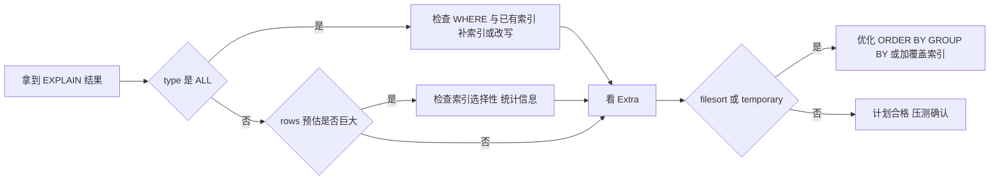

### Q155 · 用 EXPLAIN 分析执行计划

> 难度:★★★ | 标签:MySQL, EXPLAIN

**问**:拿到一条慢 SQL,你会重点看 EXPLAIN 输出的哪些字段?

**答**:重点看 type(访问类型,至少到 range,ALL 表示全表扫描)、key 与 key_len(实际用的索引及长度)、rows(预估扫描行数)、Extra(Using index 好,Using filesort / Using temporary 坏)。分析路径:先看 type 和 rows 定位是否全表,再看 key_len 判断联合索引用了几列,最后依据 Extra 决定加索引还是改写 SQL。



```python
# file: code/04_数据库与缓存/q155_explain_parse.py
"""解析 EXPLAIN 结果行, 自动标记可疑计划(以常见字段为例)"""
from typing import Any

BAD_TYPES = {"ALL", "index"}           # 全表/全索引扫描
BAD_EXTRA = ("Using filesort", "Using temporary")
GOOD_EXTRA = "Using index"


def review_plan(rows: list[dict[str, Any]]) -> list:
    findings = []
    for row in rows:
        table = row.get("table", "?")
        if row.get("type") in BAD_TYPES:
            findings.append(f"{table}: 全表扫描 type={row['type']}")
        if row.get("rows", 0) and int(row["rows"]) > 100_000:
            findings.append(f"{table}: 预估扫描 {row['rows']} 行 过大")
        extra = row.get("Extra", "")
        for bad in BAD_EXTRA:
            if bad in extra:
                findings.append(f"{table}: {bad} 需要优化排序或分组")
        if GOOD_EXTRA in extra:
            findings.append(f"{table}: 覆盖索引生效 Using index")
    return findings


if __name__ == "__main__":
    plan = [
        {"table": "orders", "type": "ALL", "rows": 500000, "Extra": "Using where; Using filesort"},
        {"table": "users", "type": "eq_ref", "rows": 1, "Extra": "Using index"},
    ]
    for msg in review_plan(plan):
        print(msg)
```

**追问**:
- type 从优到差大致顺序?——system > const > eq_ref > ref > range > index > ALL。
- EXPLAIN ANALYZE 与普通 EXPLAIN 的区别?——前者真正执行并给出实际行数与耗时,验证预估是否失真。

---
