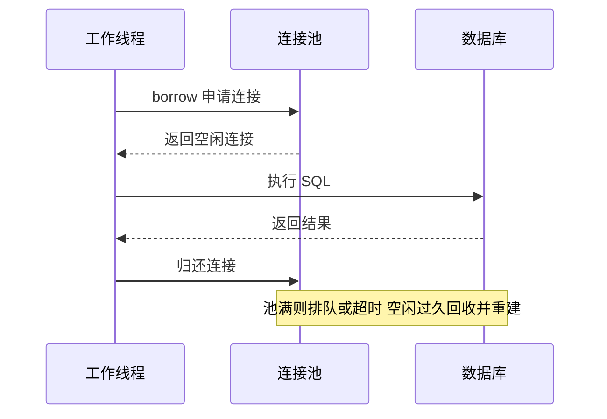

### Q157 · 数据库连接池的原理

> 难度:★★★ | 标签:数据库, 连接池

**问**:为什么需要数据库连接池?它有哪些关键参数和机制?

**答**:TCP 建连 + TLS + 认证的开销是毫秒级,高并发下频繁建断连接会拖垮性能,连接池通过复用长连接解决。关键机制:预建最小连接、上限池大小、空闲超时回收、借出/归还、健康检查(ping)与失效重建。池不是越大越好,过大反而增加 DB 上下文切换,经验公式约为 CPU 核数 * 2 + 磁盘数,再按压测调整。



```python
# file: code/04_数据库与缓存/q157_pool_concept.py
"""用队列模拟连接池的借出与归还语义"""
import queue


class FakeConn:
    def __init__(self, cid: int):
        self.cid, self.in_use = cid, False

    def execute(self, sql: str) -> str:
        return f"conn#{self.cid} 执行 {sql}"


class MiniPool:
    def __init__(self, size: int = 3):
        self.idle: queue.Queue = queue.Queue(maxsize=size)
        for i in range(size):
            self.idle.put(FakeConn(i))

    def borrow(self, timeout: float = 1.0) -> FakeConn:
        try:
            return self.idle.get(timeout=timeout)
        except queue.Empty:
            raise RuntimeError("连接池已耗尽, 请调大池或检查连接泄漏")

    def give_back(self, conn: FakeConn) -> None:
        self.idle.put(conn)


if __name__ == "__main__":
    pool = MiniPool()
    c1 = pool.borrow()
    print(c1.execute("SELECT 1"))
    pool.give_back(c1)
    print("池中空闲连接数:", pool.idle.qsize())
```

**追问**:
- 连接泄漏是什么,怎么发现?——借出不归还导致池耗尽;用池的 in_use 统计、超时强制回收、代码上保证 finally/with 归还。
- SQLAlchemy 的 pool_size / max_overflow 分别是什么?——常驻连接数与可临时溢出的连接数,超出 max_overflow + pool_size 会等待 pool_timeout。

---
