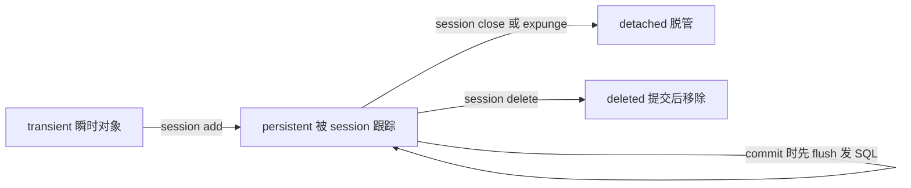

### Q161 · Session 生命周期与对象状态

> 难度:★★★★ | 标签:SQLAlchemy, ORM, session

**问**:SQLAlchemy 的 Session 应该遵循怎样的生命周期?ORM 对象有哪些状态?

**答**:Session 是 Unit of Work,生命周期应为"一次请求一个 Session":请求开始创建,结束 commit/rollback 并 close,可用上下文管理器或框架中间件托管。对象五种状态:transient(未入 session)、pending(已 add 尚未 flush)、persistent(已入库且被 session 跟踪)、detached(close 后脱离)、deleted(标记删除)。commit 时 flush 发出 SQL,过期属性在下次访问时重新加载(expire_on_commit=True)。



```python
# file: code/04_数据库与缓存/q161_session_lifecycle.py
"""用标准库模拟 SQLAlchemy Session 的 Unit of Work 状态机"""
from dataclasses import dataclass, field


@dataclass
class FakeUser:
    id: int = 0
    name: str = ""

    def __hash__(self):
        # dataclass 默认 eq=True 会把 __hash__ 置 None,对象进 set 会 TypeError;
        # ORM 的 Unit of Work 按对象身份跟踪,这里按身份散列,同一实例在 session
        # 各集合(new/dirty/persistent)中始终可识别
        return hash(id(self))


class FakeSession:
    """模拟 session 的 add / commit / close 与对象状态迁移"""

    def __init__(self):
        self.new, self.dirty, self.dead = set(), set(), set()
        self.persistent = set()
        self._seq = 0
        self.open = True

    def add(self, obj):
        self._check_open()
        self.new.add(obj)

    def _touch(self, obj):
        self._check_open()
        if obj in self.persistent:
            self.dirty.add(obj)

    def commit(self):
        self._check_open()
        print("flush:", [(o.name, "INSERT") for o in self.new],
              [(o.name, "UPDATE") for o in self.dirty])
        self._seq += len(self.new)
        for i, o in enumerate(self.new, start=self._seq):
            o.id = i
        self.persistent |= self.new
        self.new.clear()
        self.dirty.clear()

    def close(self):
        self.persistent.clear()      # 对象变 detached
        self.open = False

    def _check_open(self):
        if not self.open:
            raise RuntimeError("session 已关闭, 对象已 detached")


if __name__ == "__main__":
    session = FakeSession()
    u = FakeUser(name="alice")       # transient
    session.add(u)                   # -> pending/persistent 前
    u.name = "alice2"
    session.commit()                 # flush + 持久化
    session.close()                  # u 变 detached, 再操作会报错
    try:
        session.add(FakeUser())
    except RuntimeError as exc:
        print("捕获:", exc)
```

**追问**:
- expire_on_commit=False 有什么影响?——commit 后不再过期属性,访问 detached 对象不触发新查询,但要承担数据过期风险。
- 为什么 Web 场景推荐请求级 Session?——事务边界与请求对齐,避免长事务持锁,也保证同一请求内对象身份一致。

---
