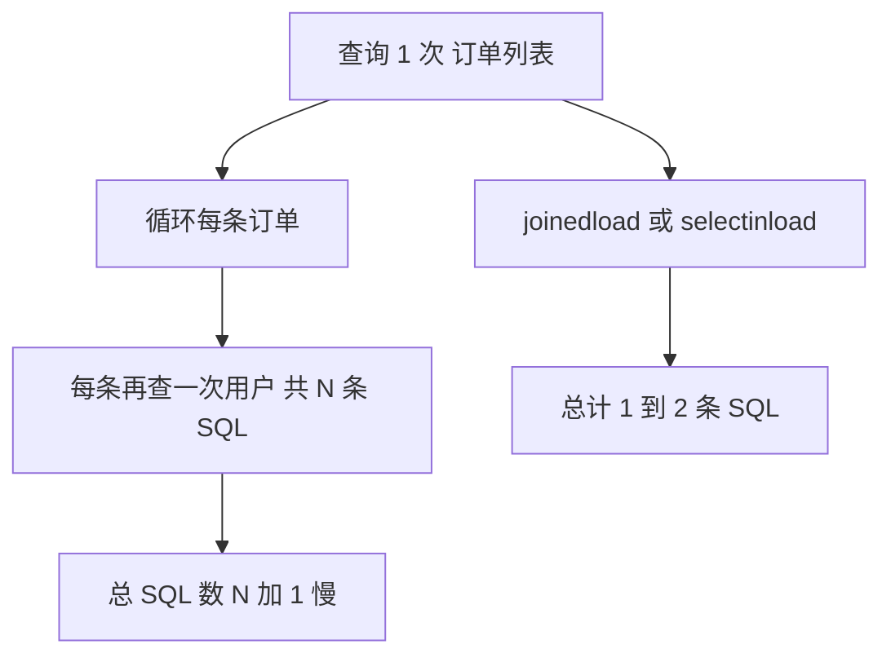

### Q162 · N+1 查询问题与解决方案

> 难度:★★★★ | 标签:SQLAlchemy, ORM, 性能

**问**:什么是 N+1 查询?如何在 SQLAlchemy 中发现并解决?

**答**:查 1 次主列表,再对每条记录各查 1 次关联对象,共 N+1 条 SQL,列表越大越慢。解决:SQLAlchemy 用 `selectinload`(第二条 IN 批量查)或 `joinedload`(LEFT JOIN 一次取回);另一种通用思路是手动收集 id 后一次 IN 查询再按 id 组装。发现手段:echo SQL、APEX 类分析工具、监控 DB QPS。



```python
# file: code/04_数据库与缓存/q162_n_plus_one.py
"""纯逻辑模拟 N+1 与两种批量加载的查询次数对比"""


class FakeDB:
    def __init__(self):
        self.users = {1: "alice", 2: "bob", 3: "carol"}
        self.orders = [{"id": i, "user_id": i % 3 + 1} for i in range(1, 31)]
        self.queries = 0

    def get_orders(self) -> list:
        self.queries += 1
        return self.orders

    def get_user(self, uid: int):
        self.queries += 1
        return self.users.get(uid)

    def get_users(self, uids: list) -> dict:
        self.queries += 1
        return {u: self.users[u] for u in set(uids)}


def lazy_load(db: FakeDB) -> list:
    """典型 N+1: 访问每条订单的 user 都触发一次查询"""
    return [(o["id"], db.get_user(o["user_id"])) for o in db.get_orders()]


def selectin_load(db: FakeDB) -> list:
    """先取订单, 收集 user_id 后一次 IN 查询, 再内存组装"""
    orders = db.get_orders()
    users = db.get_users([o["user_id"] for o in orders])
    return [(o["id"], users[o["user_id"]]) for o in orders]


if __name__ == "__main__":
    for fn in (lazy_load, selectin_load):
        db = FakeDB()
        fn(db)
        print(f"{fn.__name__}: SQL 次数 = {db.queries}")
    # SQLAlchemy 中对应: selectinload(Order.user) 或 joinedload(Order.user)
```

**追问**:
- selectinload 和 joinedload 怎么选?——多对一/一对一用 joinedload 少一次往返;一对多集合加载用 selectinload,避免 JOIN 产生笛卡尔积行数膨胀。
- 不用 ORM 时如何防 N+1?——代码评审 + ORM/SQL 层打点统计每请求 SQL 数,超过阈值告警。

---
