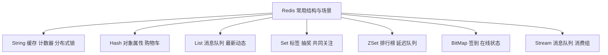

### Q165 · Redis 为什么快与数据结构总览

> 难度:★★★ | 标签:Redis, 数据结构

**问**:Redis 为什么这么快?它常用的数据结构有哪些?

**答**:快的原因:纯内存操作、单线程命令执行避免锁与上下文切换(6.0 后网络 IO 多线程但命令仍单线程)、IO 多路复用 epoll、高效数据结构(SDS 跳表 ziplist/listpack 等)。常用结构:String/Hash/List/Set/ZSet,另有 BitMap、HyperLogLog、GEO、Stream。选型要看业务语义:计数用 String 的 INCR,排行榜用 ZSet,标签交集聚合用 Set。



```python
# file: code/04_数据库与缓存/q165_redis_overview.py
"""redis-py 五大结构最小示例; 无 Redis 时用内存字典模拟语义"""
try:
    import redis
    client = redis.Redis(host="127.0.0.1", port=6379, decode_responses=True)
    client.ping()
except Exception as exc:
    print("无可用 Redis, 仅打印语义:", exc)
else:
    client.set("counter", 0)
    print("String INCR:", client.incr("counter"))                  # 1

    client.hset("cart:u1", mapping={"sku1": 2, "sku2": 1})
    print("Hash 购物车:", client.hgetall("cart:u1"))               # {'sku1': '2', ...}

    client.rpush("mq:orders", "o1", "o2")
    print("List 出队:", client.lpop("mq:orders"))                  # o1

    client.sadd("tag:python", "u1", "u2")
    client.sadd("tag:redis", "u2", "u3")
    print("Set 交集:", client.sinter("tag:python", "tag:redis"))   # {'u2'}

    client.zadd("rank", {"alice": 90, "bob": 95})
    print("ZSet 榜单:", client.zrevrange("rank", 0, -1, withscores=True))
```

**追问**:
- ZSet 底层实现?——元素少用 listpack,多时 skiplist + dict 双结构,支持 O(logN) 插入与 O(1) 查分。
- 单线程为什么还快?——瓶颈在内存与网络而非 CPU,单线程省去锁竞争;大 key 或慢命令会阻塞,要避免。

---
