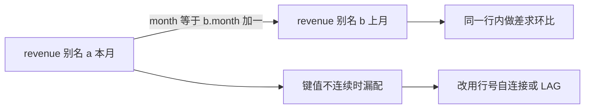

### Q1663 · 自连接应用: 相邻行比较与环比

> 难度:★★★☆ | 标签:SQL, 自连接

**问**:一张只有当月数据的月度表,不用窗口函数怎么算每个月的环比?

**答**:用自连接:同一张表起两个别名,让"本月"通过 join 条件匹配"上月",条件形如 a.month = b.month + 1,然后在 SELECT 里做差求比例。注意三点:INNER JOIN 会丢掉没有上月的首月,要看首月就改 LEFT JOIN;键值匹配依赖月份编号连续,跨年时 202612 到 202701 这种 +1 关系断裂,会漏配;ROW_NUMBER 生成行号再自连接、或直接用 LAG 窗口函数,都能免疫键不连续。自连接在无窗口函数的老库与"跨行配对"类需求(相邻行、上下级、配对去重)里仍是基本功。

```python
# file: code/04_数据库与缓存/q1663_selfjoin_adjacent.py
"""自连接应用: 相邻行比较做环比, 与窗口函数 LAG 对照"""
import sqlite3

conn = sqlite3.connect(":memory:")
conn.execute("CREATE TABLE revenue(month INTEGER PRIMARY KEY, amount REAL)")
conn.executemany("INSERT INTO revenue VALUES(?,?)",
                 [(202601, 100.0), (202602, 120.0), (202603, 90.0),
                  (202604, 110.0), (202605, 135.0)])

# 自连接: 同一张表起两个别名, 让"本月"通过 join 条件匹配到"上月"
sql = """
SELECT a.month AS cur_month, a.amount AS cur_amt, b.amount AS prev_amt,
       ROUND((a.amount - b.amount) / b.amount * 100, 1) AS pct
FROM revenue a
JOIN revenue b ON a.month = b.month + 1
ORDER BY a.month
"""
print("自连接环比:")
for m, cur, prev, pct in conn.execute(sql):
    print(f"  {m}: {cur:.0f} (上月 {prev:.0f}) 环比 {pct:+.1f}%")

# INNER JOIN 会丢掉没有上月的首月, LEFT JOIN 补齐
print("LEFT JOIN 保留首月:", conn.execute(
    "SELECT a.month, a.amount, b.amount FROM revenue a "
    "LEFT JOIN revenue b ON a.month = b.month + 1 ORDER BY a.month LIMIT 1").fetchone())

# LAG 是现代等价写法: 只扫一遍, 且不依赖键值的连续性
sql_lag = """SELECT month, amount, LAG(amount) OVER (ORDER BY month) AS prev_amt
             FROM revenue ORDER BY month"""
print("LAG 窗口版:", conn.execute(sql_lag).fetchall()[:3])
print("注意: a.month = b.month + 1 这种匹配依赖键值连续, 跨年 202612 到 202701 会漏配;")
print("      键不连续时先按 ROW_NUMBER 生成行号再自连接, 或直接用 LAG")
```



**追问**:
- 自连接和 LAG 哪个性能好?——LAG 只扫一遍且优化器友好;自连接多一次扫描与配对,但老库不支持窗口函数时是唯一解。
- 自连接要防止什么错误?——忘记限定配对条件会把 N 行与 N 行做笛卡尔积,大表上直接打爆临时空间。

---
