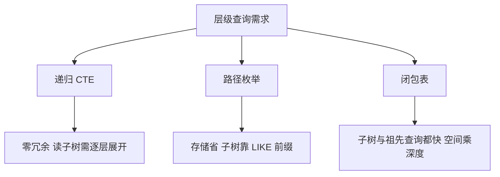

### Q1668 · 层级查询实现二: 路径枚举与闭包表

> 难度:★★★★ | 标签:SQL, 层级

**问**:递归 CTE 每次查询都要展开,读多写少的树有没有更快的方案?

**答**:两种物化方案。路径枚举:每行存整条祖先路径如 1/2/4,子树查询退化为 LIKE 'path/%' 前缀匹配,存储省、实现简单,但 LIKE 走不了理想索引,改名要重写整棵子树路径。闭包表:单独一张 ancestor-descendant-depth 表,预先展开全部祖先后代对,子树与祖先查询都是等值 JOIN,读最快,代价是空间 O(n 乘深度)、每次写要维护多行。选型口诀:读远多于写选闭包表,写频繁或树浅选路径枚举或直接递归 CTE,两者移动子树都贵,搬家要走脚本。

```python
# file: code/04_数据库与缓存/q1668_path_closure.py
"""层级查询实现二: 路径枚举与闭包表, 读多写少的两种物化方案"""
import sqlite3

conn = sqlite3.connect(":memory:")
conn.executescript("""
CREATE TABLE node(id INTEGER PRIMARY KEY, name TEXT, parent_id INTEGER, path TEXT);
CREATE TABLE closure(ancestor INTEGER, descendant INTEGER, depth INTEGER,
  PRIMARY KEY(ancestor, descendant));
INSERT INTO node VALUES
 (1, 'root', NULL, '1'),
 (2, 'a',    1,    '1/2'),
 (3, 'b',    1,    '1/3'),
 (4, 'a1',   2,    '1/2/4'),
 (5, 'b1',   3,    '1/3/5');
""")
# 闭包表: 预先展开全部祖先-后代对, 之后子树与祖先查询都是等值 JOIN
nodes = conn.execute("SELECT id, parent_id FROM node").fetchall()
by_id = dict(nodes)
pairs = []
for nid, _ in nodes:
    d, cur = 0, nid
    while cur is not None:
        pairs.append((cur, nid, d))
        d += 1
        cur = by_id.get(cur)
conn.executemany("INSERT OR REPLACE INTO closure VALUES(?,?,?)", pairs)
conn.commit()

print("闭包表查 1 的整棵子树:")
for r in conn.execute("""
  SELECT n.id, n.name, c.depth FROM closure c
  JOIN node n ON n.id = c.descendant
  WHERE c.ancestor = 1 ORDER BY c.depth"""):
    print("  ", r)

print("路径枚举查 1 的整棵子树:")
for r in conn.execute("SELECT id, name, path FROM node WHERE id = 1 OR path LIKE '1/%'"):
    print("  ", r)

print("闭包表反查 5 的全部祖先:")
for r in conn.execute("""
  SELECT n.id, n.name, c.depth FROM closure c
  JOIN node n ON n.id = c.ancestor
  WHERE c.descendant = 5 ORDER BY c.depth"""):
    print("  ", r)

print("对比: 闭包表读快但空间 O(n*深度) 且写重; 路径枚举存储小, 子树靠 LIKE 前缀;")
print("      LIKE 走不了理想索引, 且节点改名要重写整棵子树的路径, 移动子树两者都贵")
```



**追问**:
- 闭包表插入一个节点要写几行?——祖先数加一自身,深度每层一行,插入脚本里用一条 INSERT INTO closure SELECT 递归生成。
- 两种方案的一致性怎么保证?——物化列与闭包表都必须与业务写在同一事务,或由触发器/事件钩子维护,绝不允许散落在业务代码各处。

---
