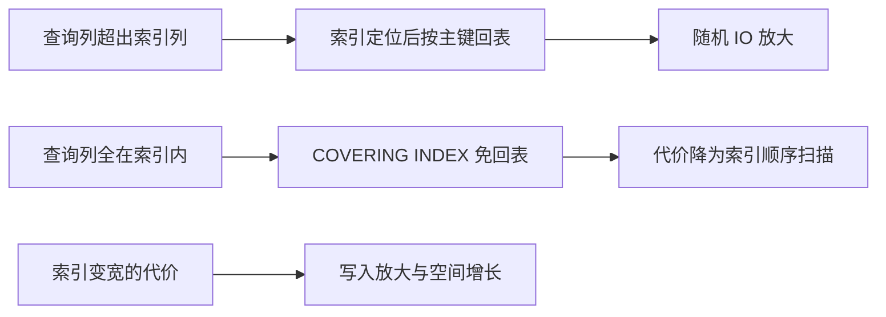

### Q1673 · covering index 实测: 让查询免于回表

> 难度:★★★☆ | 标签:SQL 调优, 索引

**问**:覆盖索引到底能快多少?怎么从执行计划确认它生效了?

**答**:当查询涉及的列全部包含在某个二级索引里时,引擎沿索引顺序扫完即得结果,完全不必按主键回表,随机 IO 消失。确认方法看执行计划:MySQL 的 Extra 列出现 Using index,SQLite 出现 USING COVERING INDEX。本机 20 万行实测,2000 次"按 user_id 求和 amount"的点查,普通索引 506ms、覆盖索引 123ms,差距正是每次约 100 次回表被消除。建覆盖索引就是给索引追加查询列,联合索引列序仍是等值列在前;代价是索引变宽带来写放大与空间增长,只对高频查询值得做。

```python
# file: code/04_数据库与缓存/q1673_covering_index.py
"""covering index 实测: 覆盖索引消除回表 的计划与耗时对比"""
import sqlite3
import time

conn = sqlite3.connect(":memory:")
conn.execute("CREATE TABLE orders(id INTEGER PRIMARY KEY, user_id INTEGER, amount REAL, memo TEXT)")
conn.executemany("INSERT INTO orders VALUES(?,?,?,?)",
                 [(i, i % 2000, (i % 97) * 1.5, "memo-%d" % i) for i in range(200000)])
conn.commit()
conn.execute("CREATE INDEX idx_user ON orders(user_id)")

sql = "SELECT SUM(amount) FROM orders WHERE user_id = ?"
print("普通索引计划:", [r[3] for r in conn.execute("EXPLAIN QUERY PLAN " + sql, (1,))])

t0 = time.perf_counter()
for u in range(2000):
    conn.execute(sql, (u,)).fetchone()
t_plain = (time.perf_counter() - t0) * 1000
print(f"普通索引 2000 次点查: {t_plain:.0f} ms (每查约 100 行, 全部要回表)")

conn.execute("CREATE INDEX idx_user_cover ON orders(user_id, amount)")
conn.execute("DROP INDEX idx_user")
conn.commit()
print("覆盖索引计划:", [r[3] for r in conn.execute("EXPLAIN QUERY PLAN " + sql, (1,))])

t0 = time.perf_counter()
for u in range(2000):
    conn.execute(sql, (u,)).fetchone()
t_cover = (time.perf_counter() - t0) * 1000
print(f"覆盖索引 2000 次点查: {t_cover:.0f} ms")
print("要点: 查询列全部落在索引内时 USING COVERING INDEX 免回表, 随机 IO 变顺序扫;")
print("      索引越宽越接近覆盖, 但写放大与空间同步上涨, 只对高频查询值得")
```



**追问**:
- SELECT * 能吃到覆盖索引吗?——基本不能,除非表的所有列都在索引里;要覆盖就先把 SELECT 列裁剪到必要集。
- 为什么列序是 user_id, amount 而不是反过来?——等值过滤列必须在前才能定位,被覆盖的载荷列放后面,这个顺序同时决定过滤与覆盖。

---
