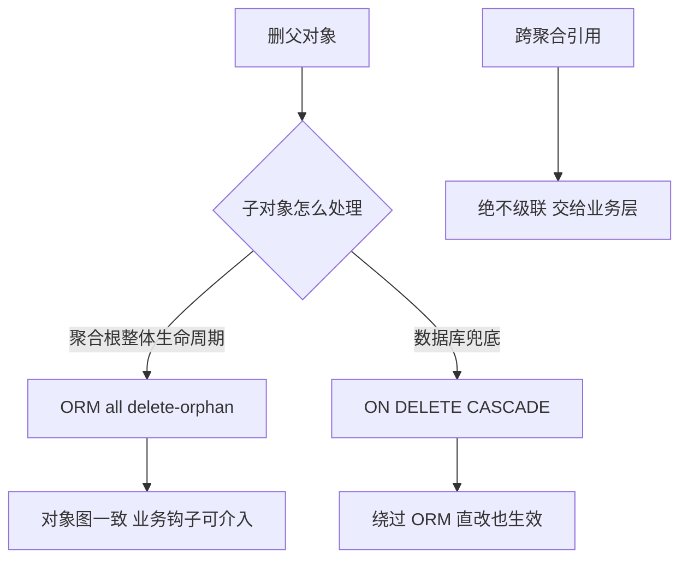

### Q1678 · 级联策略选择: cascade 谱系

> 难度:★★★☆ | 标签:ORM, 级联

**问**:ORM 的 cascade 和数据库的 ON DELETE CASCADE 是一回事吗?该怎么选?

**答**:不是一回事,管的对象不同。ORM cascade 管"对象图":save-update 与 merge 是默认行为,delete 让删父连带删子,delete-orphan 让子对象从集合移除即被删除,适合聚合根(订单-明细)整体生命周期;数据库级联管"行":ON DELETE CASCADE 绕过 ORM 直改也生效,但丢掉了对象级语义与业务钩子。选型原则:聚合内部用 ORM 的 all, delete-orphan,让事件钩子与业务规则有机会介入;跨聚合引用(订单-用户)绝不级联,交给业务层判断;两者同时开在关系上会互相踩,二选一。

```python
# file: code/04_数据库与缓存/q1678_cascade_choice.py
"""级联策略选择: ORM cascade 谱系与数据库级联的分工"""
import sqlite3

try:
    from sqlalchemy import create_engine, ForeignKey, func, select
    from sqlalchemy.orm import (Session, DeclarativeBase, Mapped, mapped_column,
                                relationship)
    HAS_SQLA = True
except ImportError:
    HAS_SQLA = False

def demo_pure():
    conn = sqlite3.connect(":memory:")
    conn.execute("PRAGMA foreign_keys=ON")
    conn.executescript("""
    CREATE TABLE parent(id INTEGER PRIMARY KEY, name TEXT);
    CREATE TABLE child(id INTEGER PRIMARY KEY,
        parent_id INTEGER REFERENCES parent(id) ON DELETE CASCADE, name TEXT);
    INSERT INTO parent VALUES(1, 'p1');
    INSERT INTO child VALUES(10, 1, 'c1'), (11, 1, 'c2');
    """)
    conn.execute("DELETE FROM parent WHERE id=1")
    conn.commit()
    print("数据库级 ON DELETE CASCADE 删父后子剩余:",
          conn.execute("SELECT COUNT(*) FROM child").fetchone()[0])
    print("分工: DB 级联管'行', 绕过 ORM 直改也生效; ORM cascade 管'对象图', 可挂业务钩子")
    print("ORM 谱系: save-update 与 merge 是默认; delete 管删父连带; delete-orphan 管从集合移除即删除")
    print("选型: 聚合根(订单-明细)用 all, delete-orphan; 跨聚合引用(订单-用户)绝不级联, 走业务层")
    print("坑: ORM cascade 与 DB ON DELETE 同时开启会互相踩, 二选一")

if HAS_SQLA:
    class Base(DeclarativeBase):
        pass

    class Parent(Base):
        __tablename__ = "parents"
        id: Mapped[int] = mapped_column(primary_key=True)
        name: Mapped[str]
        children: Mapped[list["Child"]] = relationship(cascade="all, delete-orphan")

    class Child(Base):
        __tablename__ = "children"
        id: Mapped[int] = mapped_column(primary_key=True)
        name: Mapped[str]
        parent_id: Mapped[int] = mapped_column(ForeignKey("parents.id"))

    def demo_sqla():
        engine = create_engine("sqlite://")
        Base.metadata.create_all(engine)
        with Session(engine) as s:
            s.add(Parent(id=1, name="p1",
                         children=[Child(id=10, name="c1"), Child(id=11, name="c2")]))
            s.commit()
            s.delete(s.get(Parent, 1))          # all, delete-orphan: 连带删子
            s.commit()
            print("删父后子剩余:", s.scalar(select(func.count()).select_from(Child)))
            s.add(Parent(id=2, name="p2", children=[Child(id=20, name="c20")]))
            s.commit()
            s.get(Parent, 2).children.pop()     # 从集合移除 -> delete-orphan 删除
            s.commit()
            print("从集合移除后子剩余:", s.scalar(select(func.count()).select_from(Child)))

if __name__ == "__main__":
    if HAS_SQLA:
        demo_sqla()
    else:
        print("sqlalchemy 未安装, 用 sqlite3 演示数据库级级联与 ORM 谱系对照")
        demo_pure()
```

**追问**:
- 大集合删父用 ORM 级联有什么风险?——ORM 逐行 DELETE 并逐对象处理事件,十万子对象会很慢,可改 passive_deletes=True 交给 DB 级联或批量删。
- delete-orphan 误伤的典型场景?——把子对象从集合里"挪走换新"却忘了旧对象会直接被 DELETE,业务上以为只是解绑。



---
