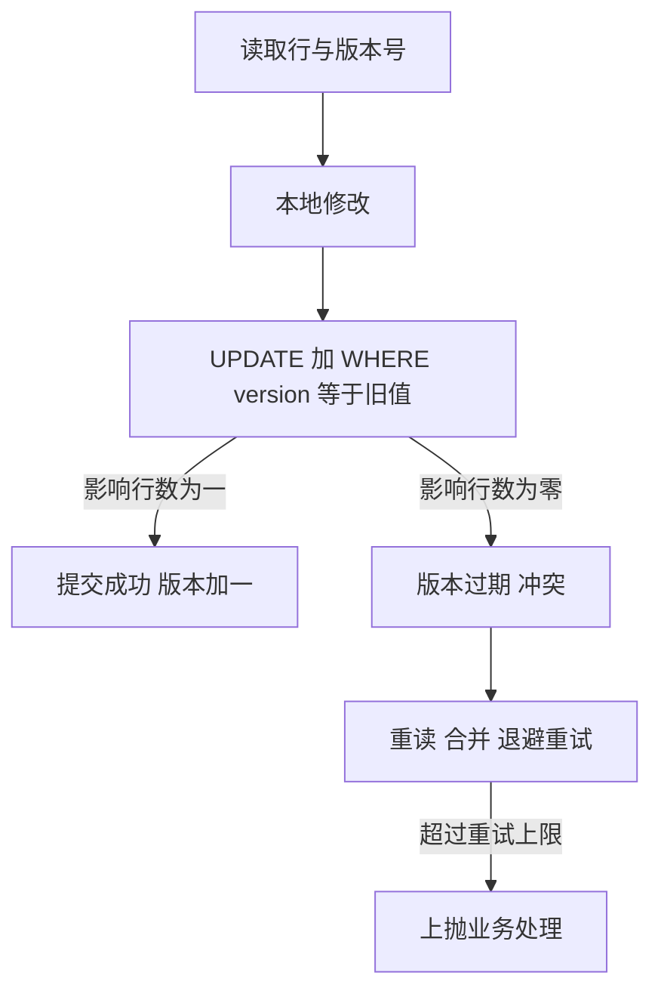

### Q1683 · version 字段并发写演示: 丢失更新如何显式化

> 难度:★★★☆ | 标签:ORM, 乐观锁

**问**:两个会话同时改同一行,为什么会"丢失更新"?版本字段怎么把它变成显式冲突?

**答**:默认的读-改-写序列里,后提交者拿旧值覆盖新值,先提交者的修改无声消失,这就是丢失更新。版本字段把它显式化:UPDATE ... SET version=version+1 WHERE id=? AND version=读到的旧版本,两个会话都基于同一版本提交时,后到的 UPDATE 影响行数为 0,框架据此抛出并发异常而不是静默覆盖。SQLAlchemy 的 version_id_col 就是这套机制,捕获后要么重读合并重试,要么提示用户"数据已被他人修改"。演示里还能看到关键纪律:冲突后的重试必须基于最新版本,旧对象直接再提交只会继续失败。

```python
# file: code/04_数据库与缓存/q1683_version_conflict.py
"""version 字段并发写演示: 两个会话同一版本的提交只有一方成功"""
import sqlite3

class ConcurrentUpdate(Exception):
    pass

conn = sqlite3.connect(":memory:")
conn.execute("CREATE TABLE doc(id INTEGER PRIMARY KEY, title TEXT, version INTEGER)")
conn.execute("INSERT INTO doc VALUES(1, 'v0', 1)")
conn.commit()

class FakeSession:
    """模拟一个 ORM 会话: 读入时记版本快照, flush 时按版本条件更新"""

    def __init__(self, conn, label):
        self.conn, self.label = conn, label
        self.obj = None

    def load(self):
        row = self.conn.execute(
            "SELECT id, title, version FROM doc WHERE id=1").fetchone()
        self.obj = {"id": row[0], "title": row[1], "version": row[2]}
        return self

    def rename(self, title):
        self.obj["title"] = title

    def flush(self):
        o = self.obj
        cur = self.conn.execute(
            "UPDATE doc SET title=?, version=version+1 WHERE id=? AND version=?",
            (o["title"], o["id"], o["version"]))
        self.conn.commit()
        if cur.rowcount == 0:
            raise ConcurrentUpdate(
                f"版本过期: 期望 version={o['version']}, 数据库已是更高版本")
        print(f"[{self.label}] 提交成功, version 升到 {o['version'] + 1}")

a = FakeSession(conn, "会话A").load()
b = FakeSession(conn, "会话B").load()
a.rename("A 改的标题")
b.rename("B 改的标题")
a.flush()
try:
    b.flush()
except ConcurrentUpdate as e:
    print("[会话B] 冲突:", e, "-> 重读合并后重试")
b = FakeSession(conn, "会话B").load()
b.rename("B 基于最新版合并的结果")
b.flush()
print("最终:", conn.execute("SELECT title, version FROM doc WHERE id=1").fetchone())
print("要点: UPDATE 的 WHERE version=? 让丢失更新变成显式冲突;")
print("      冲突处理要么重试要么提示用户, 静默覆盖是最差选择")
```



**追问**:
- 与 SELECT FOR UPDATE 比,什么时候必须用版本号?——跨服务、跨请求的长流程(用户编辑表单)没法持锁几分钟,版本号允许乐观提交,冲突时提示即可。
- 时间戳当版本有什么坑?——精度不够时两次提交同一秒会漏检,必须毫秒级以上或单调序列,整数版本最稳。

---
