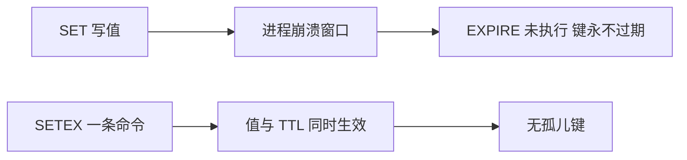

### Q1688 · SETEX 原子性: SET 与 EXPIRE 的中间窗口

> 难度:★★☆☆ | 标签:Redis, 原子性

**问**:缓存写入为什么必须用 SETEX,先 SET 再 EXPIRE 不行吗?

**答**:不行,两条命令之间有一个窗口:进程在这中间崩溃,键就带着值活着但没有 TTL,变成永不过期的孤儿键,脏缓存可能永远遮住数据库新值。SETEX(或 SET key val EX ttl)把"写值"与"注册过期"做成一个原子命令,不存在中间状态。这条规则同样约束分布式锁:SET key val NX EX ttl 一条命令完成"不存在才写加过期",老教程里 SETNX 之后再 EXPIRE 的写法,在两步之间崩溃就是死锁键。凡是"值加过期"语义的写入,一律一条命令完成。

```python
# file: code/04_数据库与缓存/q1688_setex_atomic.py
"""SETEX 原子性: SET 与 EXPIRE 两步之间的窗口会留下永不过期的孤儿键"""
import time

class FakeRedis:
    def __init__(self, crash_after_set=False):
        self.store, self.expire_at = {}, {}
        self.crash_after_set = crash_after_set

    def set(self, key, value):
        self.store[key] = value
        if self.crash_after_set:
            raise RuntimeError("进程在 SET 之后 EXPIRE 之前崩溃")

    def expire(self, key, ttl):
        self.expire_at[key] = time.time() + ttl

    def setex(self, key, value, ttl):
        self.store[key] = value              # 原子命令: 值与 TTL 同时生效
        self.expire_at[key] = time.time() + ttl

    def get(self, key):
        if key in self.expire_at and time.time() >= self.expire_at[key]:
            self.store.pop(key, None)
            self.expire_at.pop(key, None)
        return self.store.get(key)

# 两步写: 中间崩溃 -> 缓存键永不过期
r1 = FakeRedis(crash_after_set=True)
try:
    r1.set("stock:1", "999")
    r1.expire("stock:1", 60)
except RuntimeError as e:
    print("两步写失败:", e)
print("崩溃后残留:", r1.store, "-> 无 TTL 的孤儿键, 可能永远遮住新值")

# 一步写: SETEX / SET key val EX ttl, 原子生效
r2 = FakeRedis()
r2.setex("stock:1", "999", 60)
print("setex 后:", r2.get("stock:1"), "TTL 已注册, 不存在中间窗口")
print("工程规则: 任何'值加过期'的写入必须一条命令完成; SETEX 与 SET EX 等价, 后者参数更灵活")
print("同理: 分布式锁 SET NX EX 也是同一条命令, 先 SETNX 再 EXPIRE 的老写法都会留死锁键")
```



**追问**:
- 已有的孤儿键怎么清理?——用 SCAN 抽样找无 TTL 键,业务确认后批量 EXPIRE 或 DEL;上线前 TTL 巡检脚本是常规配置。
- SETEX 与 SET EX 有区别吗?——语义一致,SET 的 EX/PX/NX/XX 参数组合更全,SETEX 在部分集群代理下兼容性更好,选一个全站统一。

---
