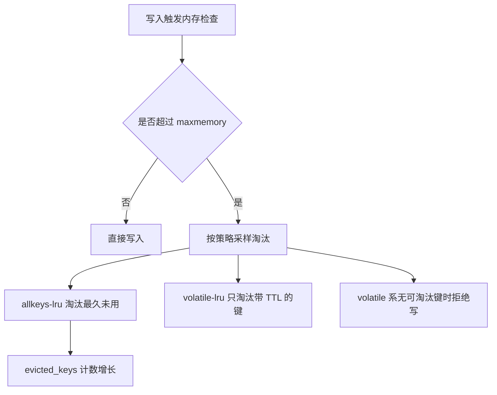

### Q1693 · 内存淘汰实测思路: 观察淘汰而不是猜

> 难度:★★★☆ | 标签:Redis, 内存

**问**:怎么验证生产 Redis 的淘汰策略按预期工作?

**答**:实测三步法。第一步灌入已知 key 集合并压到 maxmemory,让淘汰必然发生;第二步看统计:info stats 的 evicted_keys 持续增长即淘汰在发生,结合 used_memory 与 mem_fragmentation_ratio 区分是真满了还是碎片;第三步抽样探测:用之前记录的 key 列表 EXISTS 一遍,确认哪类 key 被留、哪类被逐,从而验证策略(如 allkeys-lru 淘汰最久未访问,volatile-lru 只淘汰带 TTL 的键)。要特别记住两点:Redis 的 LRU 是随机采样近似,不是精确 LRU;volatile 系列策略在没有任何可淘汰键时会直接拒绝写入,写路径要处理 OOM 报错。

```python
# file: code/04_数据库与缓存/q1693_eviction_test.py
"""内存淘汰实测思路: maxmemory 触发后 LRU 淘汰的观测与复现"""
from collections import OrderedDict

class FakeRedisLRU:
    def __init__(self, maxmemory):
        self.data = OrderedDict()
        self.maxmemory = maxmemory
        self.evicted = 0

    def set(self, key, val, size=10):
        self.data[key] = val
        self.data.move_to_end(key)                # 最近访问移到尾部
        while self._mem() > self.maxmemory:       # 超限后从头部淘汰最久未用
            self.data.popitem(last=False)
            self.evicted += 1

    def _mem(self):
        return len(self.data) * 10                # 每键按 10 单位估

r = FakeRedisLRU(maxmemory=1000)                  # 容量约 100 键
for i in range(1200):
    r.set(f"k:{i}", "v")
print(f"写入 1200 键后: 存活 {len(r.data)}, 淘汰 {r.evicted}")

# 观测手法一: 统计计数
print("真实 redis 看 info stats 的 evicted_keys 持续增长即淘汰在发生")
# 观测手法二: 前后对比探测
probe = ["k:%d" % i for i in range(0, 1200, 100)]
alive = [k for k in probe if k in r.data]
print("抽样探测存活:", alive, "-> 早期 key 已被 LRU 淘汰, 后期 key 保留")

print("实测流程: 灌入已知 key 集 -> 压到 maxmemory -> 观测 evicted_keys 与命中率 ->")
print("  抽样确认哪类 key 被淘汰 -> 对比 allkeys-lru 与 volatile-lru 的行为差异")
print("注意: 真实 redis 是近似 LRU 随机采样, 不是精确 LRU; volatile 策略下无可淘汰键时会直接拒绝写")
```



**追问**:
- evicted_keys 增长正常吗?——缓存型实例正常且需要警惕命中率下降;存储型实例出现淘汰就是数据丢失事故,必须立刻扩容或迁移。
- LFU 策略什么时候比 LRU 好?——偶发扫描会污染 LRU 的场景,LFU 按频率计数更能保住真热点。

---
