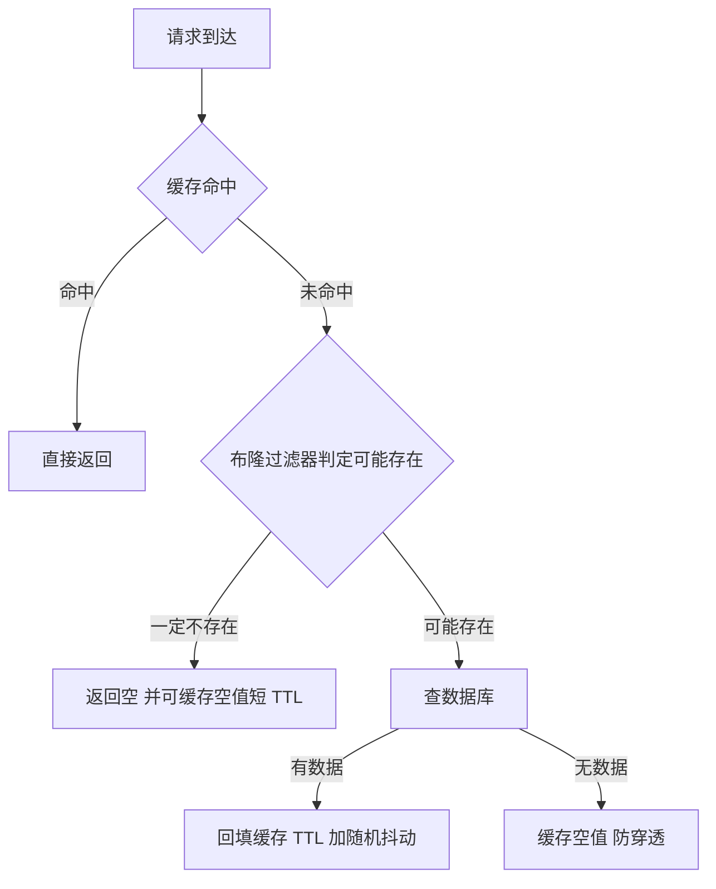

### Q170 · 缓存穿透

> 难度:★★★★ | 标签:缓存, Redis, 高可用

**问**:什么是缓存穿透?有哪些对策?

**答**:查询根本不存在的数据,缓存与 DB 都没有,每次都打到 DB,常被恶意攻击利用。对策:① 缓存空值(短 TTL)挡住重复请求;② 布隆过滤器前置,判定"一定不存在"就直接返回;③ 参数校验与接口限流,拦截非法 id。布隆过滤器有误判率但不漏判,适合海量 id 判存。



```python
# file: code/04_数据库与缓存/q170_cache_penetration.py
"""简易布隆过滤器 + 空值缓存防穿透"""
import hashlib


class BloomFilter:
    def __init__(self, bits: int = 1 << 12, hashes: int = 3):
        self.bits = bytearray(bits // 8)
        self.size = bits
        self.hashes = hashes

    def _positions(self, item: str):
        for i in range(self.hashes):
            h = int(hashlib.md5(f"{i}:{item}".encode()).hexdigest(), 16)
            yield h % self.size

    def add(self, item: str) -> None:
        for p in self._positions(item):
            self.bits[p // 8] |= 1 << (p % 8)

    def might_contain(self, item: str) -> bool:
        return all(self.bits[p // 8] >> (p % 8) & 1 for p in self._positions(item))


class Cache:
    EMPTY = object()          # 空值标记

    def __init__(self):
        self.store: dict = {}
        self.bloom = BloomFilter()
        self.db_calls = 0

    def add_id(self, key: str):
        self.bloom.add(key)

    def get(self, key: str, db_loader):
        if key in self.store:
            return self.store[key], "cache"
        if not self.bloom.might_contain(key):     # 一定不存在, 拦截
            return None, "bloom"
        self.db_calls += 1
        value = db_loader(key)
        self.store[key] = value if value is not None else self.EMPTY
        return value, "db"


if __name__ == "__main__":
    cache = Cache()
    cache.add_id("item:1")
    loader = lambda k: {"item:1": "数据A"}.get(k)
    print(cache.get("item:1", loader))     # db 加载
    print(cache.get("item:1", loader))     # cache 命中
    print(cache.get("item:404", loader))   # bloom 拦截, db_calls 不增加
    print("DB 查询次数:", cache.db_calls)
```

**追问**:
- 布隆过滤器为什么不能删元素?——一个 bit 被多个元素共享,删除会误伤;需要删除用 Counting Bloom 或布谷鸟过滤器。
- 空值缓存的 TTL 如何定?——短 TTL(如 60s)平衡攻击防护与数据一致性,配合过期抖动。

---
