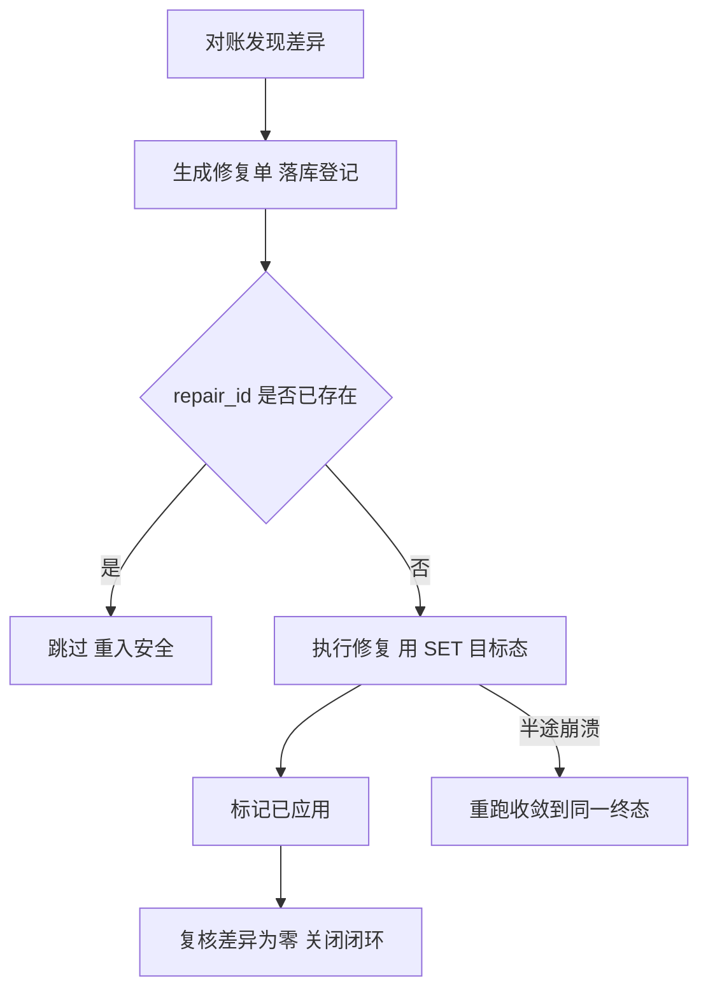

### Q1703 · 修复动作自身的幂等: 修复任务的重入安全

> 难度:★★★☆ | 标签:对账, 幂等

**问**:对账修复任务跑到一半崩了,重新执行会不会把数据修坏?

**答**:取决于修复动作的语义设计。安全的修复有两个特征:修复单登记落库,以全局唯一的 repair_id 做主键,INSERT OR IGNORE 判重,已应用过的直接跳过,重入安全;动作本身用目标态 SET 表达(把余额设为 100),而不是相对值 INCREMENT(余额加 50)——前者重跑收敛到同一终态,后者重跑翻倍伤害。反面演示里 INCREMENT 跑两次余额变 100 而不是 50。补充纪律:修复单生成与执行分离,生成时冻结差异快照,执行时按快照 SET,半途崩溃重跑时剩下的修复单继续,整体最终一致。

```python
# file: code/04_数据库与缓存/q1703_repair_idempotent.py
"""修复动作自身的幂等: 对账修复任务重跑不产生二次伤害"""
import sqlite3

conn = sqlite3.connect(":memory:")
conn.executescript("""
CREATE TABLE acct(id INTEGER PRIMARY KEY, balance INTEGER);
CREATE TABLE repair_log(repair_id TEXT PRIMARY KEY, applied_at INTEGER);
""")
conn.executemany("INSERT INTO acct VALUES(?,?)", [(1, 0), (2, 0)])
conn.commit()

def apply_repair(repair_id, target_id, set_balance):
    """幂等修复: repair_id 唯一键防重入, 动作用绝对值 SET 而非相对值 INCREMENT"""
    cur = conn.execute(
        "INSERT OR IGNORE INTO repair_log(repair_id, applied_at) "
        "VALUES(?, strftime('%s','now'))", (repair_id,))
    conn.commit()
    if cur.rowcount == 0:
        return f"{repair_id} 已应用过, 跳过"
    conn.execute("UPDATE acct SET balance=? WHERE id=?", (set_balance, target_id))
    conn.commit()
    return f"{repair_id} 应用: acct {target_id} balance -> {set_balance}"

print(apply_repair("fix-2026-1105-001", 1, 100))
print(apply_repair("fix-2026-1105-001", 1, 100), "<- 同一修复单重跑")

# 反面教材: 相对值修复重跑会翻倍伤害
def bad_repair(target_id, delta):
    conn.execute("UPDATE acct SET balance=balance+? WHERE id=?", (delta, target_id))
    conn.commit()

bad_repair(2, 50)
bad_repair(2, 50)
print("相对值 INCREMENT 跑两次:", conn.execute(
    "SELECT balance FROM acct WHERE id=2").fetchone()[0], "(伤害翻倍)")
print("要点: 修复单要登记落库并以唯一键防重入; 动作语义用目标态 SET;")
print("      半途崩溃后重跑必须收敛到同一终态, 这是修复与普通任务的分界线")
```



**追问**:
- 有些修复天然是相对动作怎么办?——包装成"以当前值加快照差值等于目标值则执行"的条件更新,或先读后算再 SET,把相对计算放应用层。
- 修复单谁来生成?——对账任务产出差异即生成修复单,与执行解耦,人工确认类修复还能加审批位。

---
