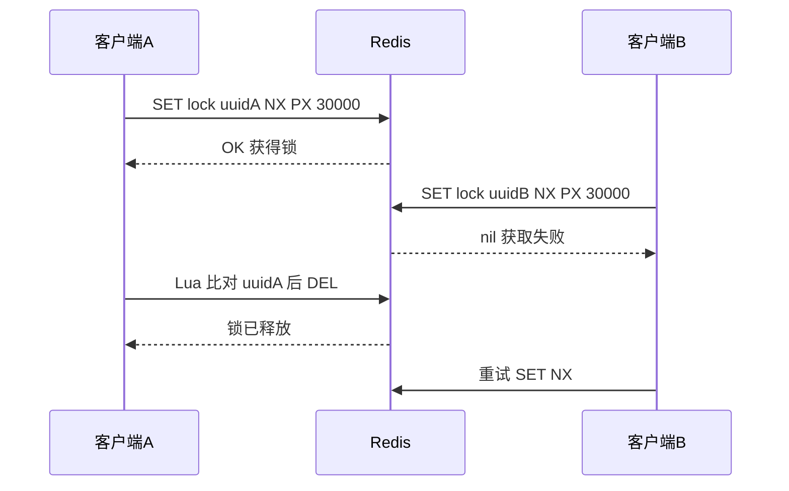

### Q173 · Redis 分布式锁 SETNX

> 难度:★★★★ | 标签:Redis, 分布式锁

**问**:如何用 Redis 实现分布式锁?释放锁要注意什么?

**答**:加锁用 `SET key unique_value NX PX 30000`:NX 保证互斥,PX 设过期防死锁,unique_value 标识持有者。释放锁必须用 Lua 脚本"先比对 value 再删除",保证"检查 + 删除"原子性,防止误删别人的锁。锁值一般用"实例 ID + 线程 ID"或 UUID。



```python
# file: code/04_数据库与缓存/q173_distributed_lock.py
"""redis-py 分布式锁: SET NX PX 加锁 + Lua 原子释放"""
import uuid

RELEASE_LUA = """
if redis.call('GET', KEYS[1]) == ARGV[1] then
    return redis.call('DEL', KEYS[1])
else
    return 0
end
"""


class RedisLock:
    def __init__(self, client, key: str, ttl_ms: int = 30_000):
        self.client = client
        self.key = key
        self.ttl_ms = ttl_ms
        self.token = str(uuid.uuid4())       # 唯一持有者标识

    def acquire(self) -> bool:
        # NX 不存在才设置, PX 过期时间, 等价 SET key token NX PX ttl
        return bool(self.client.set(self.key, self.token, nx=True, px=self.ttl_ms))

    def release(self) -> bool:
        """Lua 保证比对与删除原子, 只能释放自己持有的锁"""
        result = self.client.eval(RELEASE_LUA, 1, self.key, self.token)
        return result == 1


if __name__ == "__main__":
    try:
        import redis
        client = redis.Redis(host="127.0.0.1", port=6379)
        client.ping()
    except Exception as exc:
        print("无可用 Redis, 关键点:", exc)
        print("1 加锁必须 SET NX PX 一条命令完成 2 释放必须 Lua 比对 value 再 DEL")
    else:
        lock1, lock2 = RedisLock(client, "order:lock:42"), RedisLock(client, "order:lock:42")
        print("A 加锁:", lock1.acquire())
        print("B 加锁:", lock2.acquire())        # False 互斥
        print("B 误删尝试:", lock2.release())     # False 不是自己的锁
        print("A 释放:", lock1.release())
        print("B 再次加锁:", lock2.acquire())
```

**追问**:
- 为什么不能直接 DEL?——锁过期后若 A 的业务还没执行完,锁可能已被他人持有,直接 DEL 会误删。
- 业务超时锁过期怎么办?——看门狗续期(见 Q174),或把临界区设计得足够短。

---
