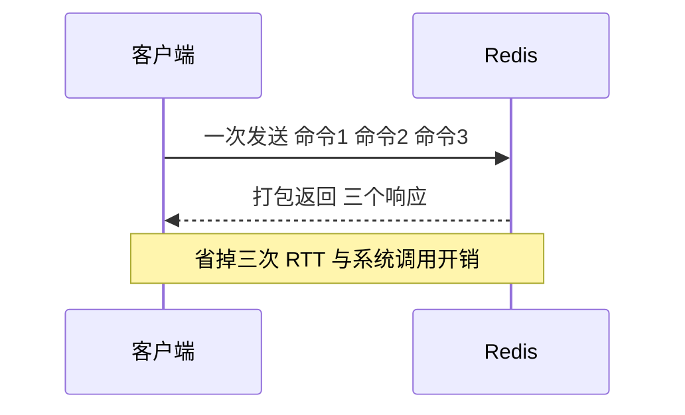

### Q175 · Redis Pipeline 与批量操作

> 难度:★★★ | 标签:Redis, pipeline, 性能

**问**:pipeline 解决什么问题?和事务、Lua 有什么区别?

**答**:pipeline 把多条命令一次性发送,省去每条命令一个 RTT 的网络开销,吞吐可提升数倍到数十倍。注意:① pipeline 只攒包不保证原子性,中间可能穿插其他客户端命令;② 需要原子性用 MULTI/EXEC 或 Lua,pipeline 可与 MULTI 叠加;③ MGET/MSET 这类原生批量命令优先于 pipeline。



```python
# file: code/04_数据库与缓存/q175_redis_pipeline.py
"""redis-py pipeline 批量写; 无 Redis 时对比逐条与攒批的往返次数模型"""
try:
    import redis
    client = redis.Redis(host="127.0.0.1", port=6379, decode_responses=True)
    client.ping()
except Exception as exc:
    print("无可用 Redis, 原理说明:", exc)
    print("逐条: N 条命令 N 次 RTT; pipeline: N 条命令 1 次 RTT")
else:
    # 逐条写: 1000 次 RTT
    for i in range(100):
        client.set(f"batch:{i}", i)

    # pipeline 写: 1 次 RTT
    with client.pipeline(transaction=False) as pipe:   # transaction=False 纯攒包
        for i in range(100):
            pipe.set(f"batch:{i}", i * 10)
        pipe.incr("pipeline:runs")
        results = pipe.execute()                        # 一次性取回全部响应

    print("pipeline 返回响应数:", len(results))
    print("计数器:", client.get("pipeline:runs"))
```

**追问**:
- pipeline 有大小限制吗?——受客户端缓冲区与 maxmemory 影响,一般每批几百到几千条,分批发送。
- MULTI/EXEC 和 pipeline 的区别?——MULTI 保证命令原子连续执行但不回滚出错命令;pipeline 只优化网络,不保证原子。

---
