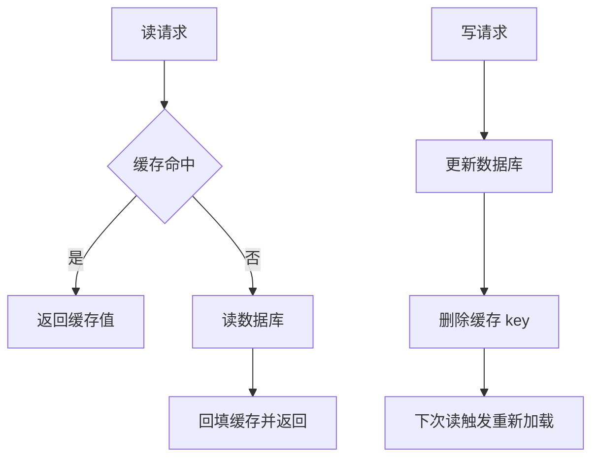

### Q177 · 旁路缓存 Cache Aside 模式

> 难度:★★★★ | 标签:缓存, 一致性

**问**:描述 Cache Aside 的读写流程,为什么是"更新 DB 后删缓存"而不是更新缓存?

**答**:读:先读缓存,未命中读 DB 并回填;写:先更新 DB,再删除缓存(而非更新)。选删除的原因:① 写后值可能再被加工,懒加载避免无效计算;② 两个并发写时"更新缓存"可能把旧值最后写入,而删缓存后下次读会加载最新值,并发窗口更小。该模式仍有极小概率不一致(读旧 DB 值晚于写删完成才回填),可用延迟双删或订阅 binlog 兜底。



```python
# file: code/04_数据库与缓存/q177_cache_aside.py
"""Cache Aside 读写路径的最小实现"""


class CacheAsideService:
    def __init__(self):
        self.cache: dict = {}
        self.db: dict = {"item:1": "v1"}
        self.db_reads = 0

    def read(self, key: str):
        if key in self.cache:
            return self.cache[key], "cache"
        self.db_reads += 1
        value = self.db.get(key)
        if value is not None:
            self.cache[key] = value
        return value, "db"

    def write(self, key: str, value: str) -> None:
        self.db[key] = value        # 第一步: 更新 DB
        self.cache.pop(key, None)   # 第二步: 删除缓存, 而不是更新


if __name__ == "__main__":
    svc = CacheAsideService()
    print(svc.read("item:1"))        # cache 未建, 读 DB
    print(svc.read("item:1"))        # 命中缓存
    svc.write("item:1", "v2")
    print(svc.read("item:1"), "写后读到新值, 缓存已被删除并重载")
    print("DB 读次数:", svc.db_reads)
```

**追问**:
- 为什么不推荐"先删缓存再更新 DB"?——删除后、DB 提交前的读会把旧值写回缓存,脏数据存活整个 TTL。
- 更新缓存在什么场景合理?——写后读极少、计算缓存值代价低且强一致需求弱时,可考虑 Write-Through。

---
