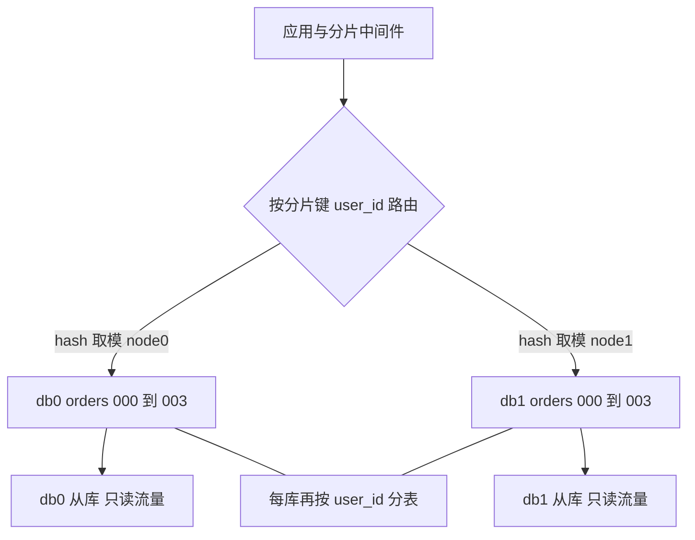

### Q182 · 分库分表的拆分思路

> 难度:★★★★ | 标签:分库分表, 架构

**问**:单表数据量过大时要拆分,说说分库分表的整体思路。

**答**:先垂直后水平:垂直分库按业务域拆(订单库/用户库),垂直分表把大字段冷字段拆出;水平分库分表按分片键(常用 user_id)把行分散到 N 库 × M 表。路由策略:hash 取模(分布均匀,扩容难)、range 按时间(利于冷热分离,有热点)、一致性 hash(扩容迁移少)。拆分前先确认单表瓶颈(2000 万行只是经验值,要看 B+Tree 层高与查询模式),能用索引、归档、读写分离解决的不要急着拆。



```python
# file: code/04_数据库与缓存/q182_sharding_router.py
"""水平分片路由: hash 取模 2 库 x 4 表"""
DB_COUNT, TABLE_PER_DB = 2, 4


def route(user_id: int) -> tuple:
    """返回 库名 与 表名"""
    shard = user_id % (DB_COUNT * TABLE_PER_DB)      # 全局槽位
    db = shard // TABLE_PER_DB
    table = shard % TABLE_PER_DB
    return f"db{db}", f"orders_{table:03d}"


if __name__ == "__main__":
    samples = [1, 2, 7, 8, 9999, 123456]
    for uid in samples:
        db, table = route(uid)
        print(f"user_id={uid} -> {db}.{table}")

    # 验证分布均匀性
    from collections import Counter
    dist = Counter(route(u)[0] for u in range(100_000))
    print("10 万用户分布:", dict(dist))
    # 扩容: 2 库扩 4 库需按新模数迁移, 一致性 hash 或 预分槽(如 1024 槽)可缓解
```

**追问**:
- 为什么用 user_id 而不是 order_id 做分片键?——用户维度查询(我的订单)可单分片命中;用 order_id 会让用户维查询扩散到全部分片。
- 什么是基因法?——把 user_id 的低位基因嵌入 order_id,订单 id 天然带用户分片信息,两种维度都能路由到单分片。

---
