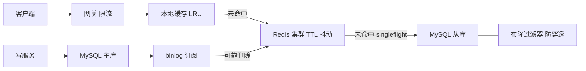

### Q185 · 综合设计: 高并发读多写少服务

> 难度:★★★★★ | 标签:架构设计, 缓存, MySQL

**问**:设计一个"读多写少、峰值 QPS 高"的商品详情服务,说说整体方案?

**答**:分层:客户端/网关限流 → 本地 LRU 缓存兜底热 key → Redis 集群存商品 JSON(TTL 加抖动) → MySQL 主从(读走从库)兜底。写路径走 Cache Aside:更新 DB 后删缓存,配合 binlog 订阅可靠删除;防穿透用布隆过滤器 + 空值缓存,防击穿用 singleflight 互斥重建;详情页统计类数据(浏览量)异步写 Redis INCR 后定时批量落库。原则:缓存挡住 99% 读,MySQL 只承接写与缓存未命中的少量读,每层都有降级(缓存挂了限流读从库)。



```python
# file: code/04_数据库与缓存/q185_service_design.py
"""综合小实现: 本地 LRU -> Redis 语义 -> DB 三级读取 + 互斥重建"""
import random
import threading
from collections import OrderedDict


class ProductDB:
    def __init__(self):
        self.data = {1: {"name": "手机", "price": 4999}}
        self.reads = 0

    def get(self, pid: int):
        self.reads += 1
        return self.data.get(pid)


class DetailService:
    def __init__(self, db: ProductDB, local_size: int = 2):
        self.db = db
        self.redis: dict = {}
        self.local: OrderedDict = OrderedDict()
        self.local_size = local_size
        self.key_locks: dict = {}
        self._guard = threading.Lock()

    @staticmethod
    def _ttl() -> float:
        return 300 * (1 + random.uniform(-0.1, 0.1))    # 雪崩防护: TTL 抖动

    def get(self, pid: int):
        if pid in self.local:                            # 第一级: 进程内
            self.local.move_to_end(pid)
            return self.local[pid], "local"
        if pid in self.redis:                            # 第二级: Redis
            self.local[pid] = self.redis[pid]
            return self.redis[pid], "redis"
        with self._lock_for(pid):                        # 第三级: 互斥回源
            if pid in self.redis:                        # 双重检查
                return self.redis[pid], "redis"
            value = self.db.get(pid)
            if value is not None:
                self.redis[pid] = value                  # 回填 + 抖动 TTL
                self.local[pid] = value
                if len(self.local) > self.local_size:
                    self.local.popitem(last=False)
            return value, "db"

    def _lock_for(self, pid: int) -> threading.Lock:
        with self._guard:
            return self.key_locks.setdefault(pid, threading.Lock())


if __name__ == "__main__":
    svc = DetailService(ProductDB())
    for _ in range(50):
        svc.get(1)
    print("50 次请求, DB 读次数:", svc.db.reads)     # 1
    print("再次读取:", svc.get(1))
```

**追问**:
- 缓存挂了怎么办?——降级为限流 + 直读从库并熔断,本地缓存延长兜底,恢复后预热。
- 浏览量这类计数如何落库?——Redis INCR 内存聚合,定时任务批量 UPDATE,牺牲实时性换 DB 写入量。
