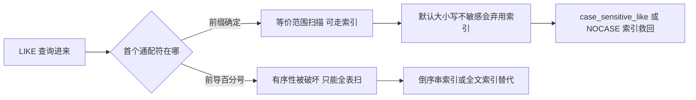

### Q1932 · LIKE 前缀与索引: 通配符位置决定生死

> 难度:★★★☆ | 标签:SQL 调优, 索引

**问**:为什么 email LIKE 'abc%' 能走索引, LIKE '%abc%' 就走不了?有没有办法救一下后缀查询?

**答**:B+Tree 索引按列值的字典序排列, 前缀确定的 LIKE 等价于一个范围扫描 abc 与 abd 之间, 所以能走索引;前导通配符破坏了有序性这个前提, 只能全表扫。SQLite 还有一个容易踩的细节:默认 LIKE 对 ASCII 大小写不敏感, 与 BINARY 排序的索引对不上, 优化器会放弃索引, 打开 case_sensitive_like 或改用 NOCASE 索引才能用上。后缀匹配的经典替代是倒序串技巧:多存一列反转字符串并建索引, 把 x% 的后缀需求翻译成前缀匹配;数据量更大或需要分词时换全文索引。实测里前缀与全扫的耗差是三个数量级, 不是纸上谈兵。

```python
# file: code/04_数据库与缓存/q1932_like_prefix_index.py
"""LIKE 与索引: 通配符位置与 case_sensitive_like 的实测"""
import sqlite3
import time

conn = sqlite3.connect(":memory:")
conn.execute("CREATE TABLE users(id INTEGER PRIMARY KEY, email TEXT)")
conn.executemany("INSERT INTO users(email) VALUES(?)",
                 [("user%05d@example.com" % i,) for i in range(50000)])
conn.execute("CREATE INDEX idx_email ON users(email)")
conn.commit()

def plan(sql):
    return " | ".join(r[3] for r in conn.execute("EXPLAIN QUERY PLAN " + sql))

q_prefix = "SELECT id FROM users WHERE email LIKE 'user005%'"
q_suffix = "SELECT id FROM users WHERE email LIKE '%@example.com'"
print("默认设置 前缀 LIKE ->", plan(q_prefix))
print("默认设置 后缀 LIKE ->", plan(q_suffix))

# 默认 LIKE 对 ASCII 大小写不敏感, BINARY 索引帮不上忙; 打开开关后前缀 LIKE 才走索引
conn.execute("PRAGMA case_sensitive_like = ON")
print("开关打开 前缀 LIKE ->", plan(q_prefix))
print("开关打开 后缀 LIKE ->", plan(q_suffix))

def timed(sql, n=5):
    t0 = time.perf_counter()
    for _ in range(n):
        conn.execute(sql).fetchall()
    return (time.perf_counter() - t0) / n * 1000

print(f"前缀 LIKE 耗时 {timed(q_prefix):6.2f} ms vs 后缀 LIKE 耗时 {timed(q_suffix):6.2f} ms")

# 后缀需求的替代: 倒序串索引
conn.execute("CREATE TABLE rev(email TEXT, email_rev TEXT)")
conn.executemany("INSERT INTO rev VALUES(?,?)",
                 [(r[0], r[0][::-1]) for r in conn.execute("SELECT email FROM users")])
conn.execute("CREATE INDEX idx_rev ON rev(email_rev)")
print("倒序串查后缀计划   ->", plan("SELECT email FROM rev WHERE email_rev LIKE 'moc.elpmaxe%'"))
print("结论: abc% 可走索引, %abc 与 %abc% 只能全扫; 后缀需求用倒序串索引或全文索引")
```



**追问**:
- MySQL 里 LIKE 走索引还需要什么前提?—— MySQL 8 的优化器对 abc% 同样做范围扫描, 但列的 collate 必须与索引一致且大小写不敏感排序需匹配, 原理相同细节不同。
- 倒序串的维护代价是什么?—— 写入时多维护一列且更新要同步反转, 属于用写放大换读性能, 只对高频后缀查询值得。

---
