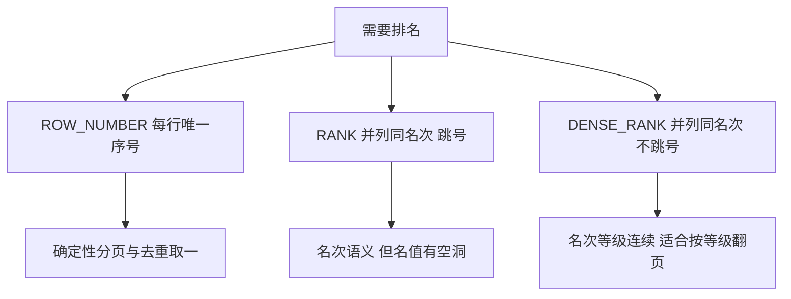

### Q1938 · RANK DENSE_RANK ROW_NUMBER: 并列名次三种口径

> 难度:★★★☆ | 标签:SQL, 窗口函数

**问**:三个排名窗口函数在并列值下分别输出什么?各自适合什么场景?

**答**:ROW_NUMBER 对每行给唯一递增序号, 并列也强行分先后;RANK 并列给相同名次并跳过后续名次, 序列形如 1 2 2 4;DENSE_RANK 并列同名次且不跳号, 序列形如 1 2 2 3。选型口诀:取每条第几名或做确定性分页用 ROW_NUMBER, 但必须补 tie-breaker 列, 否则并列行的先后不稳定;要名次并列语义用 RANK 或 DENSE_RANK, 其中 DENSE_RANK 的名次等级连续, 适合按等级翻页,RANK 的跳号会让按名值分页出现空洞。三者都支持 PARTITION BY, 组内排名时记得分区键要进排序判重。

```python
# file: code/04_数据库与缓存/q1938_rank_family.py
"""RANK DENSE_RANK ROW_NUMBER: 并列名次的三种口径"""
import sqlite3

conn = sqlite3.connect(":memory:")
conn.execute("CREATE TABLE scores(name TEXT, score INTEGER)")
conn.executemany("INSERT INTO scores VALUES(?,?)", [
    ("alice", 95), ("bob", 92), ("carol", 92), ("dave", 88), ("eve", 88), ("frank", 80)])

q = """
SELECT name, score,
       ROW_NUMBER() OVER (ORDER BY score DESC) AS rn,
       RANK()       OVER (ORDER BY score DESC) AS rk,
       DENSE_RANK() OVER (ORDER BY score DESC) AS dr
FROM scores"""
print("name     score  rn  rk  dr")
for r in conn.execute(q):
    print("%-8s %5d  %2d  %2d  %2d" % r)

# 三种口径各取前 3: 语义与结果集大小都不同
def top_by(fn):
    return [r[0] for r in conn.execute(
        "SELECT name FROM (SELECT name, " + fn +
        "() OVER (ORDER BY score DESC) AS x FROM scores) WHERE x <= 3")]

limit3 = [r[0] for r in conn.execute("SELECT name FROM scores ORDER BY score DESC LIMIT 3")]
print("LIMIT 3    ->", limit3, "纯行数截断 并列被硬拆")
print("ROW_NUMBER ->", top_by("ROW_NUMBER"), "每行唯一序号 并列被任意先后拆开")
print("RANK       ->", top_by("RANK"), "并列同名次 92 分两人都算第 2 会多取一行")
print("DENSE_RANK ->", top_by("DENSE_RANK"), "不跳号 前 3 个名次等级把 88 分也带进来")
print("结论: 取 N 条用 ROW_NUMBER 并补 tie-breaker; 取前 N 个名次等级用 DENSE_RANK; RANK 跳号会让按名次分页出现空洞")
```



**追问**:
- 没有窗口函数的老数据库怎么办?—— 用自连接 COUNT 大于法或相关子查询模拟 RANK, 用派生表加变量模拟 ROW_NUMBER, 代价都不低。
- ROW_NUMBER 的 tie-breaker 选什么列好?—— 选稳定且区分度足够的列如主键或时间戳加主键, 保证同一结果集重跑序号不变。

---
