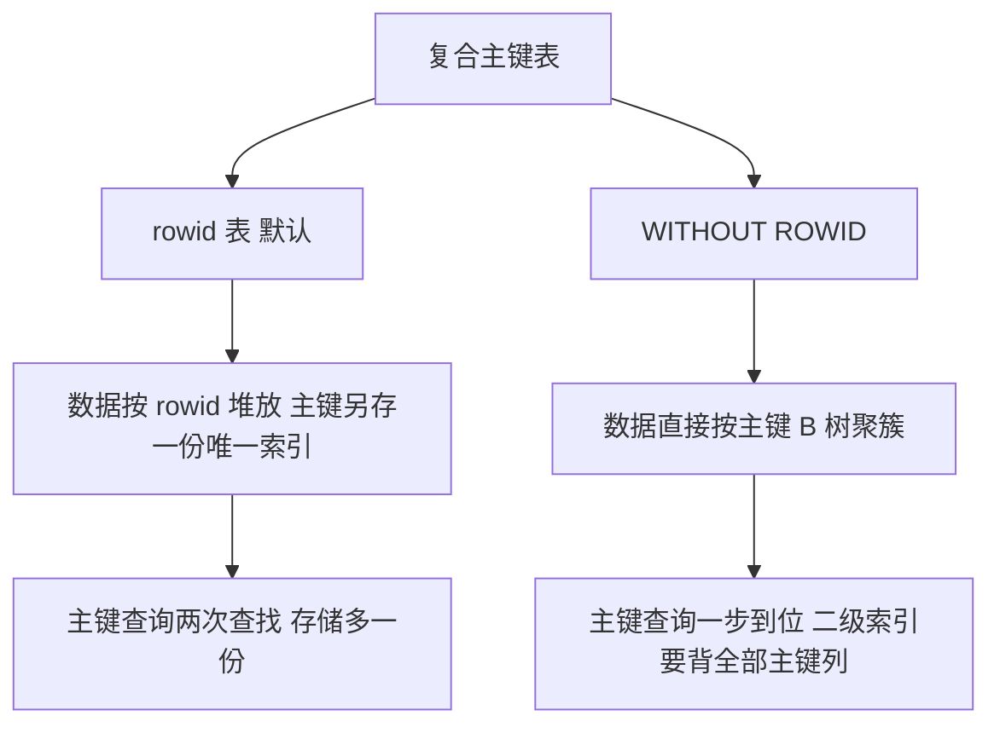

### Q1944 · WITHOUT ROWID 表: 聚簇主键的另一种组织

> 难度:★★★★ | 标签:索引, 存储结构

**问**:SQLite 的 WITHOUT ROWID 是什么?和普通 rowid 表比, 什么时候该用它?

**答**:普通 rowid 表的数据堆在 rowid BTree 里, 主键只是一份额外唯一索引, 按主键查要两次查找;WITHOUT ROWID 把整行数据直接按主键 BTree 聚簇, 主键查找一步到位, 还省掉了整份主键索引的存储。本文件实测同样五万行窄表, WITHOUT ROWID 的页数从 534 降到 381, 主键范围查耗时差一个量级。代价在二级索引上:它的叶子必须背全部主键列来定位行, 主键越宽、行越大, 二级索引膨胀越狠, 实测加一个索引后页数回升到 501。选型口诀:窄行、复合主键、以主键点查为主的表用它;宽行、大 blob、多二级索引或频繁全表扫的表别用。

```python
# file: code/04_数据库与缓存/q1944_without_rowid.py
"""WITHOUT ROWID 表: 复合主键的另一种物理组织与实测"""
import sqlite3
import time

def build(without_rowid):
    c = sqlite3.connect(":memory:")
    tail = " WITHOUT ROWID" if without_rowid else ""
    c.execute("CREATE TABLE readings(dev_id INTEGER, ts INTEGER, value REAL, note TEXT, "
              "PRIMARY KEY(dev_id, ts))" + tail)
    c.executemany("INSERT INTO readings VALUES(?,?,?,?)",
                  [(i % 200, i, i * 0.5, "note-%d" % i) for i in range(50000)])
    c.commit()
    return c

a = build(False)
b = build(True)
print("rowid 表       page_count =", a.execute("PRAGMA page_count").fetchone()[0])
print("WITHOUT ROWID  page_count =", b.execute("PRAGMA page_count").fetchone()[0],
      "(数据本身聚簇在主键 B 树里 不再存一份主键索引)")

def plan(c, sql):
    return " | ".join(r[3] for r in c.execute("EXPLAIN QUERY PLAN " + sql))

q = "SELECT value FROM readings WHERE dev_id = 7 AND ts BETWEEN 1000 AND 1100"
print("rowid 表计划      ->", plan(a, q))
print("WITHOUT ROWID 计划 ->", plan(b, q))

def timed(c, sql, n=5):
    t0 = time.perf_counter()
    for _ in range(n):
        c.execute(sql).fetchall()
    return (time.perf_counter() - t0) / n * 1000

print(f"rowid 表耗时 {timed(a, q):.2f} ms  WITHOUT ROWID 耗时 {timed(b, q):.2f} ms")

# WITHOUT ROWID 的代价: 大字段被冗余进每一个二级索引
b.execute("CREATE INDEX idx_ts ON readings(ts)")
a.execute("CREATE INDEX idx_ts ON readings(ts)")
print("加二级索引后 WITHOUT ROWID page_count =", b.execute("PRAGMA page_count").fetchone()[0],
      "(二级索引要背全部主键列)")
print("结论: 以复合主键点查为主的窄行表适合 WITHOUT ROWID; 宽行 多二级索引或大 blob 慎用")
```



**追问**:
- WITHOUT ROWID 表还有 rowid 吗?—— 没有, rowid 概念消失, 不能再依赖隐式 rowid 排序, 所有访问都应显式走主键。
- InnoDB 有对应概念吗?—— InnoDB 主键本来就是聚簇的, 这张表更接近 InnoDB 的默认行为, WITHOUT ROWID 反而是让 SQLite 向主流看齐。

---
