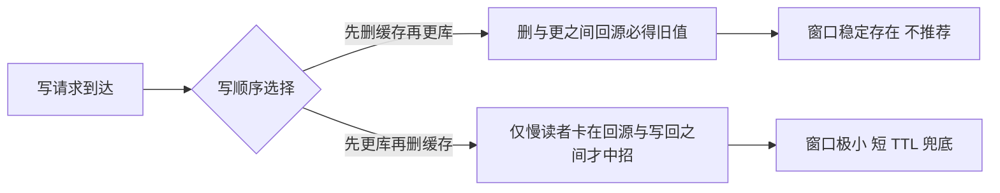

### Q1950 · 旁路缓存写路径: 两种写顺序的竞态

> 难度:★★★☆ | 标签:缓存, 一致性

**问**:先更新数据库再删缓存, 和先删缓存再更新数据库, 哪种更安全?竞态窗口长什么样?

**答**:用手工时序模拟可以把两种写顺序的竞态窗口摆出来。先删缓存再更库:删与更之间任何一次读都会回源拿到旧值并写回缓存, 窗口稳定存在, 缓存必然脏;先更库再删缓存:只有读请求恰好卡在回源之后、写回之前, 且写者恰好完成了更库与删缓存, 旧值才会落进缓存, 窗口小得多但确实存在, 这就是经典的慢读者竞态。所以工程结论是先更库再删缓存, 残余风险靠短 TTL 收敛, 强一致场景再加延迟双删或订阅 binlog 二次失效。本文件还演示了写完后缓存已失效的状态是安全的, 因为下一次读会回源修复。

```python
# file: code/04_数据库与缓存/q1950_cache_aside_write.py
"""旁路缓存写路径: 两种写顺序的竞态窗口时序模拟"""

class Store:
    def __init__(self):
        self.db = 10
        self.cache = 10        # 初始已缓存

def reader_miss_repair(s):
    """读路径未命中: 回源后把读到的值写回缓存"""
    s.cache = s.db
    return "读: 回源读到 %d 并写回缓存" % s.db

def steps_update_then_delete(new):
    """先更新库再删缓存"""
    return [("写1: 更新库", lambda s: setattr(s, "db", new)),
            ("写2: 删缓存", lambda s: setattr(s, "cache", None))]

def steps_delete_then_update(new):
    """先删缓存再更新库"""
    return [("写1: 删缓存", lambda s: setattr(s, "cache", None)),
            ("写2: 更新库", lambda s: setattr(s, "db", new))]

def interleave(order_steps, reader_at):
    """reader_at 指定在写者第几步之后插入一次未命中读"""
    s = Store()
    log = []
    for i, (name, fn) in enumerate(order_steps):
        fn(s)
        log.append(name)
        if reader_at == i:
            log.append(reader_miss_repair(s))
    if reader_at is not None and reader_at >= len(order_steps):
        log.append(reader_miss_repair(s))
    return s, log

for order_name, factory in [("先更库再删缓存", steps_update_then_delete),
                            ("先删缓存再更库", steps_delete_then_update)]:
    for reader_at in (0, 1, 2):
        s, log = interleave(factory(20), reader_at if reader_at < 2 else None)
        pos = "写第%d步后" % (reader_at + 1) if reader_at < 2 else "写完之后"
        if s.cache is None:
            verdict = "缓存已失效 下次读回源"
        elif s.cache == s.db:
            verdict = "一致"
        else:
            verdict = "陈旧!"
        print(f"{order_name} 读插在{pos} -> db={s.db} cache={s.cache} {verdict}")

# 残余竞态: 读者在写开始前回源拿到旧值 醒来后才写回缓存 两种顺序都会中招
s = Store()
pending = s.db                      # 读者拿到旧值 10 后卡住
for name, fn in steps_update_then_delete(20):
    fn(s)
s.cache = pending                   # 读者醒来把旧值写回
print(f"慢读者残余竞态 -> 库已是 20 缓存被写回旧值 {s.cache} 永久陈旧 只能靠短 TTL 或延迟双删收敛")
print("结论: 先更库再删缓存是四种顺序里竞态窗口最小的 残余风险由 TTL 兜底")
```



**追问**:
- 延迟双删的延迟怎么定?—— 取主从延迟加一次回源耗时的上界, 通常几百毫秒, 本质是给慢读者写回旧值的时间窗留缓冲。
- 为什么不推荐更新缓存而不是删缓存?—— 更新缓存有写写覆盖与写放大两个问题, 删除把一致性收敛为一次未命中, 成本更低。

---
