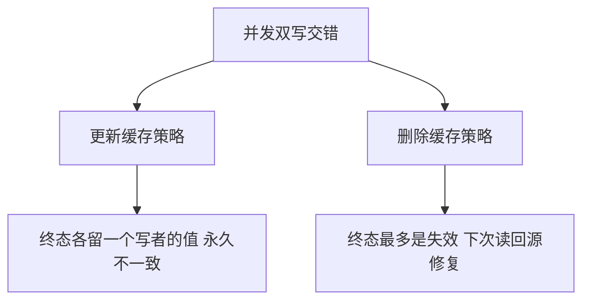

### Q1956 · 双写顺序实测: 四种写策略并发终态

> 难度:★★★★ | 标签:缓存, 一致性

**问**:更新缓存与删除缓存、先后顺序, 四种组合在并发写者下分别是什么结局?

**答**:把两个写者交错执行的手工时序摆出来, 结论非常清晰。先更缓存再更库与先更库再更缓存:两个写者的步骤交错后, 缓存与数据库各留下不同写者的值, 终态永久不一致, 没有任何自愈机制。先更库再删缓存与先删缓存再更库:交错终态最多是缓存被删成失效, 下一次读回源即修复, 不一致被收敛为一次未命中。这就是写路径统一用删除缓存的根本原因:删除是幂等的、可收敛的, 更新缓存在并发下是赌运气。再叠加读路径的慢读者竞态与 TTL 兜底, 构成 Cache Aside 的完整一致性论证。

```python
# file: code/04_数据库与缓存/q1956_dual_write_order.py
"""双写顺序实测: 四种写策略在并发写者交错下的终态"""

def run_two_writers(steps_fn):
    """写者 A 写 X 写者 B 写 Y 交错顺序固定为 A1 B1 B2 A2"""
    state = {"db": "old", "cache": "old"}
    a = steps_fn("X")
    b = steps_fn("Y")
    for fn in [a[0]] + b + a[1:]:
        fn(state)
    return state

def cache_then_db(v):
    return [lambda s, v=v: s.__setitem__("cache", v),
            lambda s, v=v: s.__setitem__("db", v)]

def db_then_cache(v):
    return [lambda s, v=v: s.__setitem__("db", v),
            lambda s, v=v: s.__setitem__("cache", v)]

def db_then_del(v):
    return [lambda s, v=v: s.__setitem__("db", v),
            lambda s, v=v: s.__setitem__("cache", "GONE")]

def del_then_db(v):
    return [lambda s, v=v: s.__setitem__("cache", "GONE"),
            lambda s, v=v: s.__setitem__("db", v)]

for name, fn in [("先更缓存再更库", cache_then_db),
                 ("先更库再更缓存", db_then_cache),
                 ("先更库再删缓存", db_then_del),
                 ("先删缓存再更库", del_then_db)]:
    s = run_two_writers(fn)
    if s["cache"] == "GONE":
        verdict = "缓存失效 下次读回源修复 可接受"
    elif s["cache"] == s["db"]:
        verdict = "一致"
    else:
        verdict = "永久不一致"
    print(f"{name}: db={s['db']} cache={s['cache']} -> {verdict}")
print("结论: 并发写者交错下 更新缓存类策略终态直接脏 删缓存类策略把不一致收敛成一次未命中 所以写路径用删除")
```



**追问**:
- 读多写少的数据可以直接更新缓存吗?—— 可以, 配合分布式锁串行化同 key 写者后更新缓存可行, 但复杂度高于删缓存, 除非回源成本极高。
- 删除缓存失败怎么办?—— 进重试队列或订阅 binlog 补偿删除, 最终一致由 TTL 兜底, 关键是不能静默丢失删除动作。

---
