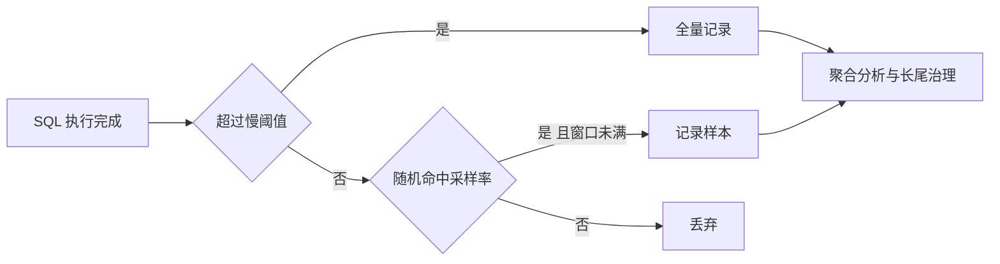

### Q1961 · 慢查询采样器: 全量阈值加概率抽样

> 难度:★★★☆ | 标签:运维, 慢查询

**问**:全量记录 SQL 日志会把系统打爆, 采样又怕漏掉慢查询, 怎么平衡?

**答**:正确的采样策略是分层记录:超过慢阈值的查询全量捕获, 这是长尾治理的主对象;低于阈值的正常查询按低概率抽样并加窗口限流, 目的是保留正常流量的画像而不是审计每一条。本文件的采样器实测四百条查询里十条慢查询全部记录, 快查询按一成抽样加每秒上限, 总日志量压到个位数百分比。实现要点:阈值与采样率可动态下发, 便于故障时临时提高采样;窗口限流防止正常流量突增时日志被冲爆;捕获条目带执行计划快照与参数脱敏, 慢查询要能直接复现。慢日志的价值在闭环, 采集之后必须有聚合分析与治理动作。

```python
# file: code/04_数据库与缓存/q1961_slow_query_sampler.py
"""慢查询采样器: 全量阈值记录加概率抽样"""
import random
import time

random.seed(3)

class SlowQuerySampler:
    def __init__(self, threshold_ms=20.0, sample_rate=0.1, max_per_window=5):
        self.threshold_ms = threshold_ms
        self.sample_rate = sample_rate
        self.window = 1.0
        self.window_start = time.monotonic()
        self.logged_in_window = 0
        self.max_per_window = max_per_window
        self.captured = []
        self.total = 0
        self.slow_total = 0
    def observe(self, sql, elapsed_ms):
        self.total += 1
        now = time.monotonic()
        if now - self.window_start > self.window:
            self.window_start = now
            self.logged_in_window = 0
        if elapsed_ms >= self.threshold_ms:
            self.slow_total += 1
            self.captured.append((sql, round(elapsed_ms, 1)))
            return True
        if random.random() < self.sample_rate and self.logged_in_window < self.max_per_window:
            self.captured.append((sql, round(elapsed_ms, 1)))
            self.logged_in_window += 1
            return True
        return False

sampler = SlowQuerySampler()
queries = []
for i in range(400):
    if i % 40 == 0:
        queries.append(("SELECT * FROM orders WHERE user_id = ? 慢", 35 + random.random() * 10))
    else:
        queries.append(("SELECT * FROM users WHERE id = ?", random.random() * 15))

kept = 0
for sql, ms in queries:
    if sampler.observe(sql, ms):
        kept += 1
print(f"总查询 {sampler.total}  慢查询 {sampler.slow_total} 全量捕获")
print(f"快速查询按 {sampler.sample_rate:.0%} 抽样 共记录 {kept} 条 日志量压到 {kept / sampler.total:.1%}")
print("捕获样例 ->", sampler.captured[:6])
print("结论: 慢查询全量记录 快查询低概率抽样加窗口限流 既保住长尾可见性又不把日志打爆")
```



**追问**:
- 阈值定多少合适?—— 按业务 P99 定, 通常是正常耗时的十倍以上, 区分 OLTP 与报表场景分开设阈值。
- 为什么还要采样正常查询?—— 慢查询治理需要对照画像:正常查询的形态与耗时分布是判断异常的基线, 低频抽样成本可忽略。

---
