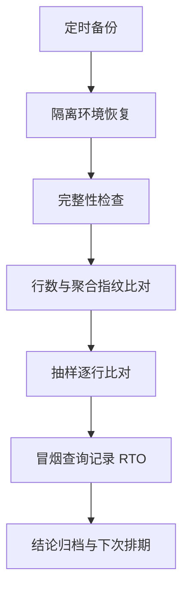

### Q1966 · 备份恢复演练: 清单与自动验证

> 难度:★★☆☆ | 标签:运维, 备份

**问**:备份系统的建设标准是什么?为什么说没演练过的备份等于没有备份?

**答**:备份的可靠性只能用恢复验证来证明, 演练清单九步:定时备份任务与保留策略;用一致性快照接口备份而不是拷贝热文件, SQLite 用 backup API, MySQL 用 xtrabackup 或 mysqldump 加单事务;在隔离环境恢复;integrity_check 或校验位验证文件完整;行数比对;聚合指纹比对, 即行数合计与极值四元组;抽样逐行比对;冒烟查询验证业务可用并记录 RTO;演练结论归档、下次演练排期、备份任务失败挂告警。本文件的脚本把这九步里可自动化的部分全部落成代码, 实测恢复验证秒级完成。演练频率建议季度一次全量恢复加月度抽查, 大版本升级与迁移前必须加练。

```python
# file: code/04_数据库与缓存/q1966_backup_restore_drill.py
"""备份恢复演练: 清单与自动验证脚本"""
import os
import sqlite3
import tempfile
import time

src = os.path.join(tempfile.mkdtemp(), "prod.sqlite")
conn = sqlite3.connect(src)
conn.execute("CREATE TABLE orders(id INTEGER PRIMARY KEY, amount INTEGER)")
conn.executemany("INSERT INTO orders(amount) VALUES(?)", [(i % 97,) for i in range(10000)])
conn.commit()

# 第 1 步: 用 backup API 拿一致性快照 而不是拷贝热文件
bak = os.path.join(tempfile.mkdtemp(), "bak.sqlite")
with sqlite3.connect(bak) as dst:
    conn.backup(dst)
print("1 备份完成 文件大小:", os.path.getsize(bak), "字节")

# 第 2-5 步: 隔离环境恢复并做四层验证
r = sqlite3.connect(bak)
print("2 integrity_check:", r.execute("PRAGMA integrity_check").fetchone()[0])
n_src = conn.execute("SELECT COUNT(*) FROM orders").fetchone()[0]
n_bak = r.execute("SELECT COUNT(*) FROM orders").fetchone()[0]
print(f"3 行数比对: 源 {n_src} 备 {n_bak}", "一致" if n_src == n_bak else "不一致!")

fp_src = conn.execute("SELECT COUNT(*), SUM(amount), MIN(id), MAX(id) FROM orders").fetchone()
fp_bak = r.execute("SELECT COUNT(*), SUM(amount), MIN(id), MAX(id) FROM orders").fetchone()
print("4 聚合指纹比对:", fp_src == fp_bak, fp_bak)

smp_src = conn.execute("SELECT * FROM orders WHERE id % 997 = 0 ORDER BY id").fetchall()
smp_bak = r.execute("SELECT * FROM orders WHERE id % 997 = 0 ORDER BY id").fetchall()
print("5 抽样逐行比对:", smp_src == smp_bak, f" 共 {len(smp_bak)} 行")

# 第 6-9 步: 冒烟测可用性 记录 RTO 归档结论 排期下次演练 挂告警
t0 = time.perf_counter()
_ = r.execute("SELECT SUM(amount) FROM orders").fetchone()
print(f"6 冒烟查询可用 恢复验证耗时 {1000 * (time.perf_counter() - t0):.1f} ms")
print("7 演练结论归档  8 下次演练排期  9 备份任务失败挂告警")
print("结论: 备份的价值等于最近一次恢复演练 没验证过可恢复的备份等于没有备份")
```



**追问**:
- RTO 与 RPO 分别指什么?—— RTO 是恢复到可用的时间目标, RPO 是可容忍的数据丢失窗口, 备份频率与恢复速度分别对应这两条指标。
- 备份文件放哪里?—— 跨介质跨机房保存至少两份, 一份离线或对象存储防误删与勒索, 权限收敛到备份账号。

---
