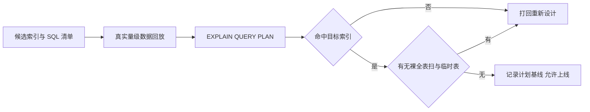

### Q1971 · 索引上线前 EXPLAIN 门禁: 计划断言自动化

> 难度:★★★★ | 标签:迁移, 索引

**问**:新索引上线前怎么做评审?EXPLAIN 校验怎么从人工看一眼变成自动化门禁?

**答**:索引的价值必须用执行计划证明, 门禁自动化分四步:准备真实量级的数据回放, 小数据量下优化器可能选错计划误导评审;对目标 SQL 逐条跑 EXPLAIN QUERY PLAN 提取计划文本;断言三件事, 命中期望索引、没有无索引支撑的裸全表扫描、没有意外的临时表与排序;断言不过就打回, 通过则把计划文本存为基线, 上线后对比漂移。本文件实测建索引前两条 SQL 都被裸 SCAN 拦截, 建索引后全部命中目标索引通过。这个门禁可以直接挂进 CI 与工单流程, 评审从看截图变成跑脚本。注意 EXPLAIN 是估算不含执行, 深度验证要配合 ANALYZE 与真实耗时基准。

```python
# file: code/04_数据库与缓存/q1971_explain_gate.py
"""索引上线前 EXPLAIN 门禁: 计划断言自动化"""
import sqlite3

conn = sqlite3.connect(":memory:")
conn.execute("CREATE TABLE orders(id INTEGER PRIMARY KEY, user_id INTEGER, status TEXT, amount INTEGER)")
conn.executemany("INSERT INTO orders VALUES(?,?,?,?)",
                 [(i, i % 5000, "paid" if i % 3 else "open", i % 1000) for i in range(30000)])
conn.commit()

def plan_details(sql):
    return [r[3] for r in conn.execute("EXPLAIN QUERY PLAN " + sql)]

def gate(sql, must_use=None):
    """上线门禁: 必须命中期望索引 且不允许无索引支撑的全表扫描"""
    details = plan_details(sql)
    problems = []
    if must_use and must_use not in " | ".join(details):
        problems.append("未命中期望索引 %s" % must_use)
    for d in details:
        if d.startswith("SCAN") and "USING" not in d:
            problems.append("全表扫描: %s" % d)
    return problems, details

cases = ["SELECT * FROM orders WHERE user_id = 42",
         "SELECT * FROM orders WHERE status = 'paid' AND amount > 500"]
print("--- 建索引前 门禁应当拦截 ---")
for sql in cases:
    problems, details = gate(sql)
    print("拦截 ->", problems or "通过", "  计划:", details[0] if details else "")

conn.execute("CREATE INDEX idx_o_user ON orders(user_id)")
conn.execute("CREATE INDEX idx_o_status_amt ON orders(status, amount)")
conn.commit()
print("--- 建索引后 重新过门禁 ---")
for sql in cases:
    must = "idx_o_user" if "user_id" in sql else "idx_o_status_amt"
    problems, details = gate(sql, must_use=must)
    print("通过 ->" if not problems else "仍拦截 ->", problems or must, "  计划:", details[0])
print("结论: 索引评审要跑在真实量级数据上 门禁断言三件事 命中目标索引 无裸全表扫 无意外临时表与排序")
```



**追问**:
- 为什么用真实量级数据?—— 小表时优化器倾向全表扫, 索引收益显不出来, 还可能因为统计信息误差选错索引, 评审结论会失真。
- 基线漂移监控怎么做?—— 定期重跑目标 SQL 对比计划文本与耗时, 漂移即告警, 常见于统计信息过期或数据分布变化。

---
