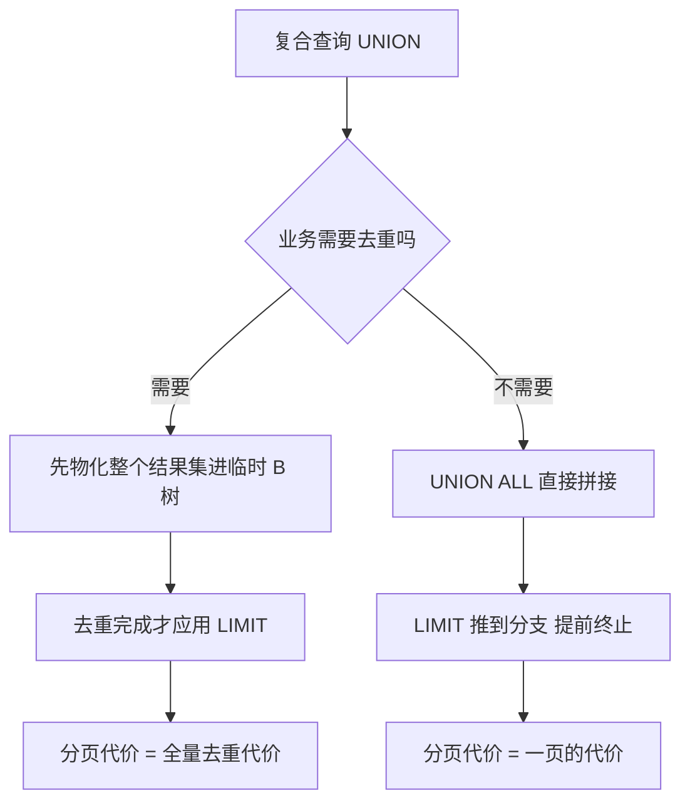

### Q2204 · UNION 与 UNION ALL 分页: 去重把 LIMIT 的便宜吃掉了

> 难度:★★★☆ | 标签:SQL, UNION, 分页

**问**:为什么"两个结果集各取一页再合并"和"合并后再取一页"代价差这么多?

**答**:UNION 的语义是去重,而去重必须先拿到全部候选行(通常进临时 B 树排序),LIMIT 是在去重完成之后才生效的——分页的便宜被去重的全量成本吃掉。UNION ALL 不去重,两边可以各自提前终止,LIMIT 推到分支上直接短路。所以工程规则是:确定不会重复、或重复可容忍时一律 UNION ALL;确需去重时,先用 GROUP BY 在源头收敛(把去重范围限制在必要列),再拼接分页。此外 UNION 的输出顺序无契约,分页必须显式 ORDER BY,而去重 + 排序叠加时要注意排序列必须包含在去重键内,否则去重会破坏排序的确定性。

```python
# file: code/04_数据库与缓存/q2204_union_pagination.py
"""UNION 与 UNION ALL 分页: 去重要先物化整个结果集, LIMIT 救不了"""
import sqlite3
import time

conn = sqlite3.connect(":memory:")
c = conn.cursor()
c.execute("CREATE TABLE hot(id INTEGER PRIMARY KEY, tag TEXT)")
c.execute("CREATE TABLE cold(id INTEGER PRIMARY KEY, tag TEXT)")
c.executemany("INSERT INTO hot VALUES(?,?)",
              [(i, "t%d" % (i % 97)) for i in range(1, 20001)])
c.executemany("INSERT INTO cold VALUES(?,?)",
              [(i, "t%d" % (i % 97)) for i in range(1, 20001)])

for label, sql in [
    ("UNION     + LIMIT 10", "SELECT id FROM hot UNION SELECT id FROM cold LIMIT 10"),
    ("UNION ALL + LIMIT 10", "SELECT id FROM hot UNION ALL SELECT id FROM cold LIMIT 10"),
]:
    plan = " | ".join(r[3] for r in c.execute("EXPLAIN QUERY PLAN " + sql))
    t0 = time.perf_counter()
    n = len(c.execute(sql).fetchall())
    ms = (time.perf_counter() - t0) * 1000
    print("%s -> %5d 行 %6.1f ms | %s" % (label, n, ms, plan))
print("计划可见: UNION 带 USE TEMP B-TREE FOR UNION, 先全量去重; UNION ALL 无临时结构, 提前终止")
```

**追问**:
- 两边数据完全不相交时 UNION 会快吗?—— 优化器一般不知道不相交,仍按去重处理;明确不相交就写 UNION ALL,语义与性能双赢。
- 想去重又想快怎么办?—— 先各自 DISTINCT 再 UNION ALL,去重范围缩小到每个子集,代价低于全量 UNION 的临时 B 树。



---
