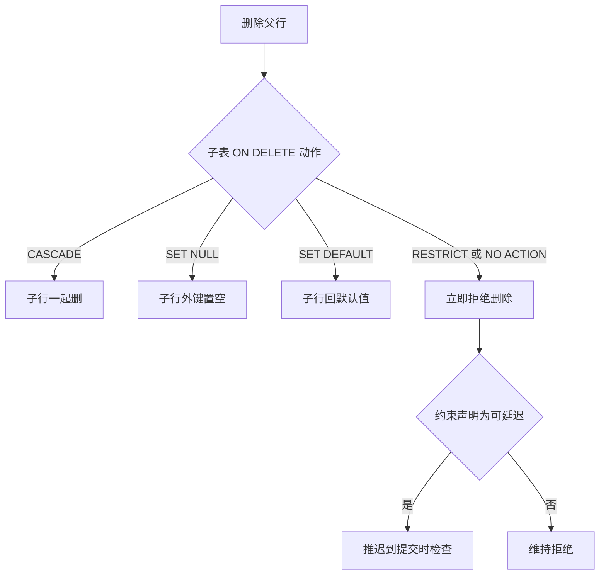

### Q2209 · 约束级联 ON DELETE 行为表: 五种动作一张表

> 难度:★★★★ | 标签:SQL, 外键, 级联

**问**:把 ON DELETE 的五种动作各自的效果说清楚,NO ACTION 和 RESTRICT 有什么区别?

**答**:CASCADE 子行跟随删除;SET NULL 子行外键置空(列须可空);SET DEFAULT 置回列默认值(默认值仍须满足外键);RESTRICT 与 NO ACTION 都会阻止删除父行,区别在检查时机:RESTRICT 是立即检查,不可推迟;NO ACTION 默认也是立即检查,但配 DEFERRABLE INITIALLY DEFERRED 可以推迟到事务提交时检查,从而允许事务内部"先破坏后修复"。所有动作生效前提是 foreign_keys 处于开启状态,SQLite 默认关闭,这是面试与生产都高频翻车的点。选型经验:强归属关系用 CASCADE,解关联用 SET NULL,审计要求高的表拒绝级联、显式走归档流程。

```python
# file: code/04_数据库与缓存/q2209_on_delete_matrix.py
"""ON DELETE 行为表: 五种级联动作在删除父行后的实际效果"""
import sqlite3

conn = sqlite3.connect(":memory:")
c = conn.cursor()
c.execute("PRAGMA foreign_keys=ON")

actions = [
    ("CASCADE",     "ON DELETE CASCADE"),
    ("SET NULL",    "ON DELETE SET NULL"),
    ("SET DEFAULT", "ON DELETE SET DEFAULT"),
    ("RESTRICT",    "ON DELETE RESTRICT"),
    ("NO ACTION",   "ON DELETE NO ACTION"),
]
for i, (name, action) in enumerate(actions, 1):
    tag = "c%d" % i
    c.execute("CREATE TABLE parent_%s(id INTEGER PRIMARY KEY)" % tag)
    c.execute("CREATE TABLE child_%s(pid INTEGER DEFAULT 0 REFERENCES parent_%s(id) %s)"
              % (tag, tag, action))
    if name == "SET DEFAULT":
        c.execute("INSERT INTO parent_%s VALUES(0)" % tag)   # 默认值 0 本身也是合法父行
    c.execute("INSERT INTO parent_%s VALUES(1)" % tag)
    c.execute("INSERT INTO child_%s(pid) VALUES(1)" % tag)
    try:
        c.execute("DELETE FROM parent_%s WHERE id=1" % tag)
        row = c.execute("SELECT pid FROM child_%s" % tag).fetchone()
        outcome = "子行已级联删除" if row is None else "子行仍在, pid = %s" % row[0]
        print("%-12s -> 删除成功, %s" % (name, outcome))
    except sqlite3.IntegrityError as e:
        print("%-12s -> 删除被拒绝: %s" % (name, str(e)[:40]))
conn.commit()
print("前提是 PRAGMA foreign_keys=ON, SQLite 默认关闭时全部动作形同虚设")
```

**追问**:
- 事务里先删子再删父,NO ACTION 能过吗?—— 默认不能(逐条检查),声明 DEFERRABLE INITIALLY DEFERRED 后提交时才检查,顺序无关。
- 级联删除是同步的吗?—— 是,在删除语句的事务内同步执行,大级联会放大锁持有时间与 binlog 体积,深层级联要预估行数。



---
