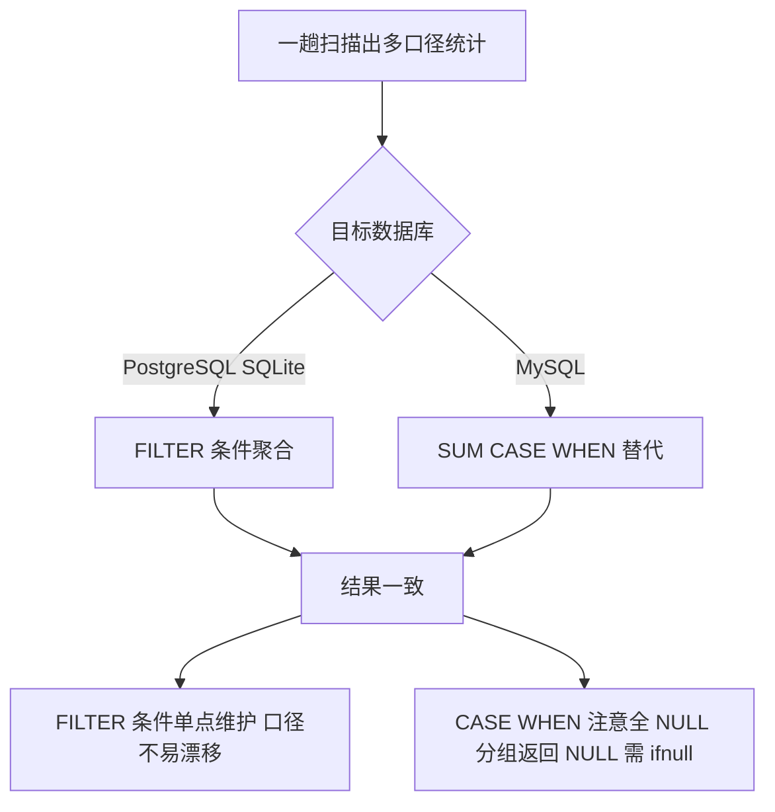

### Q2214 · FILTER 条件聚合: 一趟扫描出多口径

> 难度:★★☆☆ | 标签:SQL, 聚合

**问**:一个分组要同时统计成功数、失败数、退款数,写多个子查询还是 CASE WHEN?

**答**:都不是首选,标准写法是聚合 FILTER 子句:count(*) FILTER (WHERE status='ok'),SQL:2003 标准语法,PostgreSQL 与 SQLite(3.30+)原生支持,一趟扫描完成所有口径,可读性远超嵌套 CASE。MySQL 尚未支持时用 SUM(CASE WHEN cond THEN 1 ELSE 0 END) 等价替代,注意 SUM 遇到全 NULL 分组返回 NULL,要 ifnull 包一层。两者结果完全一致,差别在表达力与出错概率:FILTER 的条件只写一遍,口径漂移风险小;多层 CASE WHEN 复制粘贴时最容易改漏一处条件。报表类查询优先 FILTER,兜底方案写清注释。

```python
# file: code/04_数据库与缓存/q2214_filter_aggregate.py
"""FILTER 条件聚合: 一趟扫描出多口径统计"""
import sqlite3

conn = sqlite3.connect(":memory:")
c = conn.cursor()
c.execute("CREATE TABLE pay(id INTEGER PRIMARY KEY, channel TEXT, status TEXT, amt REAL)")
c.executemany("INSERT INTO pay VALUES(?,?,?,?)",
              [(1, "wx", "ok", 100.0), (2, "wx", "fail", 50.0), (3, "ali", "ok", 200.0),
               (4, "ali", "refund", 30.0), (5, "wx", "ok", 70.0), (6, "ali", "ok", 120.0)])

sql_filter = """
SELECT channel,
       count(*) FILTER (WHERE status = 'ok')     AS ok_cnt,
       sum(amt) FILTER (WHERE status = 'ok')     AS ok_amt,
       count(*) FILTER (WHERE status = 'fail')   AS fail_cnt,
       count(*) FILTER (WHERE status = 'refund') AS refund_cnt
FROM pay GROUP BY channel
"""
print("FILTER 写法   channel  ok笔数  ok金额  fail  refund")
for r in c.execute(sql_filter):
    print("   %-5s %6d %8.1f %5d %6d" % r)

sql_case = """
SELECT channel,
       sum(CASE WHEN status='ok' THEN 1 ELSE 0 END),
       sum(CASE WHEN status='ok' THEN amt ELSE 0 END),
       sum(CASE WHEN status='fail' THEN 1 ELSE 0 END),
       sum(CASE WHEN status='refund' THEN 1 ELSE 0 END)
FROM pay GROUP BY channel
"""
print("CASE WHEN 等价:", [tuple(r) for r in c.execute(sql_case)])
print("两种写法同结果, FILTER 条件只写一遍, 口径不易漂移, MySQL 用 CASE WHEN 兜底")
```

**追问**:
- FILTER 能用在哪些聚合上?—— 所有聚合函数,count/sum/avg/array_agg 都行,本质是给聚合加一个行级开关。
- 条件里能用别的列吗?—— 能,WHERE 子句里合法的表达式都可以,常用于"近 7 天成功单"这类带时间窗的口径。



---
