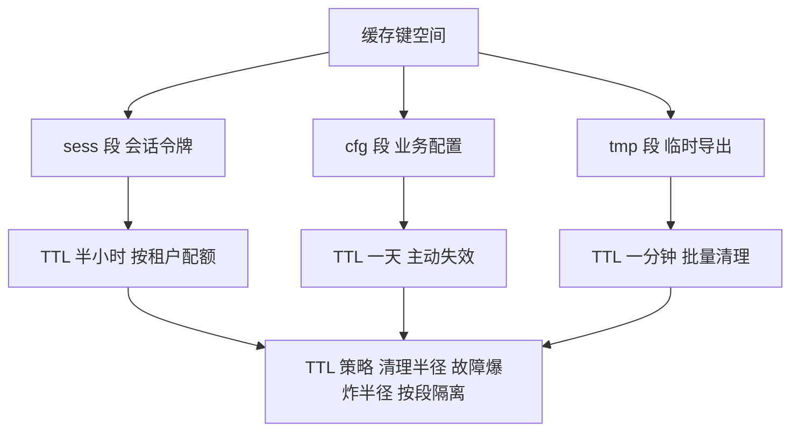

### Q2219 · 键空间分段: 前缀即命名空间

> 难度:★★☆☆ | 标签:缓存, 键设计

**问**:为什么缓存键都要求带前缀分段?只是好看吗?

**答**:前缀是键空间的管理单元,TTL 策略、容量配额、批量清理、故障爆炸半径都按段隔离。会话段的 TTL 是半小时、配置段是一天、临时导出段是一分钟,混在一起就没法按语义设过期;按租户分段后配额与限流有清晰的归属,一家失控不会拖垮全局;清理与排查时,按前缀 SCAN 的范围可控,避免 SCAN 全库;出事故时"只清某一类键"的动作半径被前缀框住。反过来,分段也要防滥用:层级过深让键名冗长、统计困难,两到三层(业务:租户:语义)是常见平衡。键规范要当成 API 来维护,写进模板与 lint,而不是口头约定。

```python
# file: code/04_数据库与缓存/q2219_keyspace_segments.py
"""键空间分段: 前缀即命名空间, 隔离 TTL 配额与清理半径"""

class SegmentedCache:
    def __init__(self):
        self.data = {}

    def set(self, seg, key, value, ttl=None, quota=None):
        full = seg + ":" + key
        if quota is not None:
            same = [k for k in self.data if k.startswith(seg + ":")]
            if len(same) >= quota:
                victim = same[0]
                print("  段 %s 超配额, 先淘汰 %s" % (seg, victim))
                del self.data[victim]
        self.data[full] = (value, ttl)
        return full

    def clear_segment(self, seg):
        victims = [k for k in self.data if k.startswith(seg + ":")]
        for k in victims:
            del self.data[k]
        return len(victims)

    def keys(self):
        return sorted(self.data)

cache = SegmentedCache()
cache.set("sess", "u1", "token-a", ttl=1800)
cache.set("sess", "u2", "token-b", ttl=1800)
cache.set("cfg", "pay_channel", "on", ttl=86400)
cache.set("tmp", "export-1", "bytes...", ttl=60)
print("现有键:", cache.keys())
n = cache.clear_segment("tmp")
print("只清 tmp 段, 删了 %d 个键 -> 清理半径被前缀框住" % n)
print("剩余键:", cache.keys())
cache.set("tmp", "x1", "a", quota=1)
cache.set("tmp", "x2", "b", quota=1)
print("分段让 TTL 配额 清理 故障半径都按段隔离, 键规范要当成 API 维护")
```

**追问**:
- SCAN 按前缀清理会不会阻塞?—— SCAN 渐进遍历不阻塞,但要分批加间隔,大前缀清理安排在低峰并限速。
- 分段与集群 hash tag 冲突吗?—— 用花括号 tag 强制同槽会放大倾斜,一般按段独立散列,只在需要多键原子操作时对同一业务键组用 tag。

---



---
