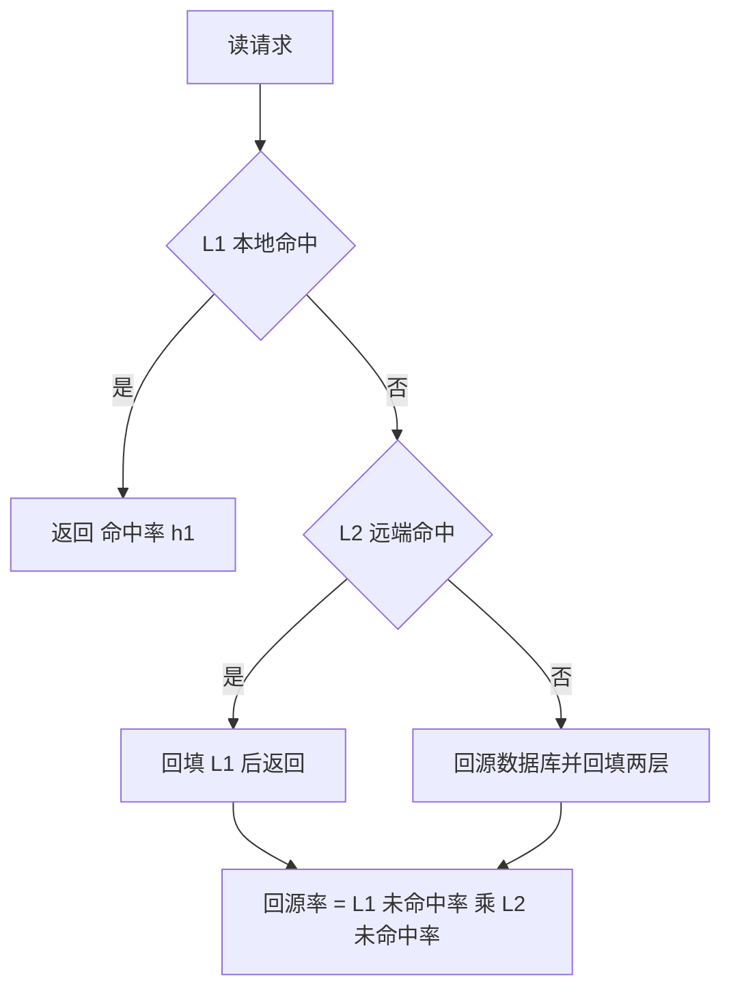

### Q2224 · 多级缓存命中率叠加: 回源率是乘法

> 难度:★★★☆ | 标签:缓存, 容量

**问**:L1 命中率 60%,L2 命中率 80%,整体命中率是多少?

**答**:不是相加,回源率是两级未命中率的乘积:请求先过 L1,未过的 40% 再过 L2,L2 也未过的 40%×20%=8% 才会打数据库,所以整体命中率 92%。两个推论:第一,L1 的边际收益被放大——L1 提升一个点,直接按剩余比例减少回源;第二,L2 的命中率要用"L1 未命中的请求"作分母才有意义,直接拿全量请求算会得出错误的乐观估计。仿真验证时给两层配独立 LRU,按真实访问分布(Zipf)回放,理论值与实测通常吻合;偏差主要来自回填策略(是否回填 L1)与 L1 被失效广播打断的部分。容量规划时用这个乘法反推数据库的 QPS 压力,比拍脑袋可靠得多。

```python
# file: code/04_数据库与缓存/q2224_layered_hit_rate.py
"""多级缓存命中率叠加: 回源率是两级未命中率的乘积"""
import random
from collections import OrderedDict

def new_lru(size):
    return {"size": size, "data": OrderedDict(), "hit": 0, "miss": 0}

def lru_get(c, k):
    if k in c["data"]:
        c["data"].move_to_end(k)
        c["hit"] += 1
        return "v"
    c["miss"] += 1
    return None

def lru_put(c, k):
    if k in c["data"]:
        c["data"].move_to_end(k)
    c["data"][k] = True
    if len(c["data"]) > c["size"]:
        c["data"].popitem(last=False)

random.seed(11)
N = 20000
keys = random.choices(range(500), k=N)          # 访问分布带热点
l1, l2, origin = new_lru(50), new_lru(300), {"n": 0}
for k in keys:
    key = "k%d" % k
    if lru_get(l1, key) is None:
        if lru_get(l2, key) is None:
            origin["n"] += 1
            lru_put(l2, key)
        lru_put(l1, key)

h1 = l1["hit"] / N
h2 = l2["hit"] / l1["miss"]
print("L1 命中率 %.1f%%, L2 对未命中部分命中率 %.1f%%" % (h1 * 100, h2 * 100))
print("理论回源率 (1-h1)*(1-h2) = %.1f%%, 实测回源 %d 次 = %.1f%%" % (
    (1 - h1) * (1 - h2) * 100, origin["n"], origin["n"] * 100.0 / N))
print("乘法关系: L1 每提一个点, 回源按剩余比例直接减少")
```

**追问**:
- 为什么 L2 的命中率分母是 L1 未命中?—— 只有穿过 L1 的请求才会到 L2,全量请求做分母会低估 L2 的真实贡献。
- 回填策略影响什么?—— L2 命中后是否回填 L1、回源后是否同时填两层,直接改变两级命中率分布,仿真要与线上一致。

---



---
