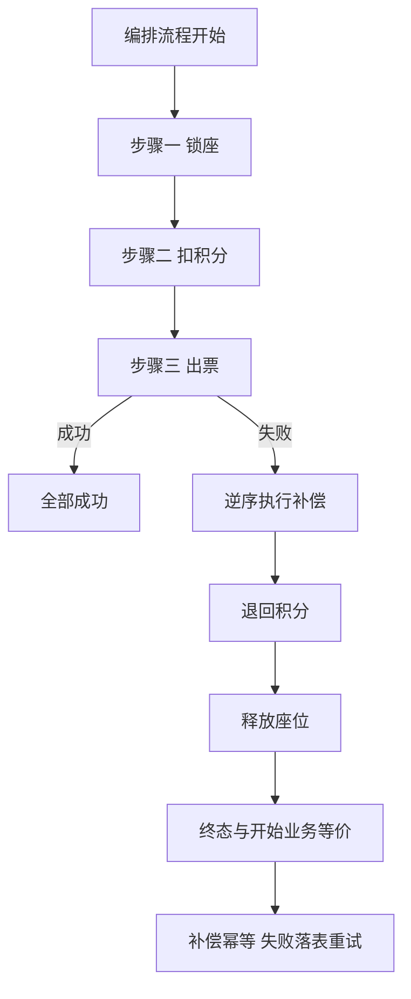

### Q2229 · 部分失败的补偿事务: 逆序回滚到一致

> 难度:★★★★ | 标签:事务, 分布式

**问**:跨三个服务的预订流程,第三步失败了,前两步怎么撤?

**答**:补偿事务(compensating transaction):每一步成功后登记它的"逆操作",任一步失败就从最后一步往前逐个执行补偿,把系统拉回业务等价的状态。与数据库回滚的区别:补偿是业务动作,不可依赖底层事务,因此每条补偿必须幂等(重复执行效果不变)、必须可重试,补偿自身失败要落补偿表由后台继续,不能放弃。实现要点:正向步骤按序登记(描述,逆操作);失败时逆序遍历;终态断言——补偿完成后检查核心资源是否回到初始等价态。适用边界:短流程、步骤少、补偿容易表达(锁座释放、扣分返还);长流程与外部不可逆动作(发短信、出库)要改用"先落状态机再异步推进"的 saga 形态,补偿只是其中一环。

```python
# file: code/04_数据库与缓存/q2229_compensating_tx.py
"""部分失败的补偿事务: 每步登记逆操作, 失败逆序补偿"""

class Flow:
    def __init__(self):
        self.done = []   # (描述, 逆操作)

    def step(self, desc, do, undo):
        try:
            do()
        except Exception as e:
            print("  步骤[%s]失败: %s" % (desc, e))
            self.rollback_all()
            return False
        self.done.append((desc, undo))
        print("  步骤[%s]成功" % desc)
        return True

    def rollback_all(self):
        for desc, undo in reversed(self.done):
            undo()
            print("  补偿[%s]完成" % desc)

class Booking:
    def __init__(self):
        self.seat = "free"
        self.points = 100

    def lock(self):
        self.seat = "locked"
    def unlock(self):
        self.seat = "free"
    def deduct(self):
        if self.points - 500 < 0:
            raise ValueError("积分不足")
        self.points -= 500
    def refund(self):
        self.points += 500          # 幂等前提: 与扣减严格配对
    def issue(self):
        raise RuntimeError("出票服务 5xx")

bk = Booking()
flow = Flow()
print("预订流程开始")
flow.step("锁座", bk.lock, bk.unlock)
flow.step("扣积分", bk.deduct, bk.refund)
flow.step("出票", bk.issue, None)
flow.rollback_all()                 # 补偿重复执行验证幂等
print("终态 座位=%s 积分=%d <- 与初始等价" % (bk.seat, bk.points))
print("补偿必须幂等且可重试, 补偿失败要落表重试, 不可逆动作不进同步流程")
```

**追问**:
- 补偿和数据库回滚什么时候混用?—— 单库内的多表写放一个真事务里回滚,跨资源或跨服务的部分才用补偿,能用本地事务就不要拆成 saga。
- 出票这步想做成可恢复怎么办?—— 先落"待出票"状态与本地消息表,同步接口立刻返回受理,后台推进并在失败时重试,超时进入人工队列。



---
