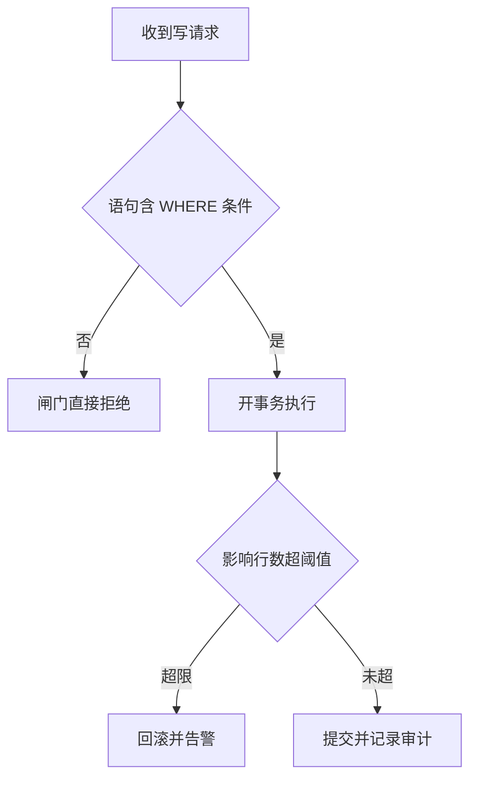

### Q2234 · 忘加 WHERE 的危险 UPDATE: 客户端闸门加行数断言

> 难度:★★☆☆ | 标签:安全, 数据保护

**问**:怎么从工程上防止"UPDATE 忘了 WHERE"这种事故,只靠 review 够吗?

**答**:不够,要有机械防线。三层由廉价到昂贵:客户端闸门——所有人工或脚本化 DML 走统一入口,正则拒绝缺 WHERE 的 UPDATE/DELETE,并强制包事务、预检影响行数(同条件先 SELECT count 或执行后断言 rowcount <= 阈值),超限回滚;服务端防线——MySQL 的 sql_safe_updates 强制 WHERE 带索引列或 LIMIT,只读账号隔离日常查询权限;流程防线——变更单、双人复核、生产操作录屏审计。闸门的两个细节必须做对:预检与执行之间数据可能变化,所以用事务内 rowcount 断言兜底;阈值按表规模配置,别用全局常数把大表的合法批量更新全拦死。

```python
# file: code/04_数据库与缓存/q2234_safe_update_guard.py
"""忘加 WHERE 的危险 UPDATE: 客户端闸门加影响行数断言"""
import re
import sqlite3

conn = sqlite3.connect(":memory:")
conn.isolation_level = None    # 关闭隐式事务, BEGIN COMMIT ROLLBACK 全部显式控制
c = conn.cursor()
c.execute("CREATE TABLE users(id INTEGER PRIMARY KEY, level INTEGER, banned INTEGER)")
c.executemany("INSERT INTO users VALUES(?,?,?)", [(1, 1, 0), (2, 2, 0), (3, 1, 0)])

DANGER = re.compile(r"^\s*(UPDATE|DELETE)\s+(?!.*\bWHERE\b)", re.I | re.S)

def guarded_execute(conn, sql, max_affected=1000):
    if DANGER.match(sql):
        raise ValueError("拒绝执行: UPDATE 或 DELETE 缺少 WHERE")
    cur = conn.cursor()
    cur.execute("BEGIN")
    cur.execute(sql)
    n = cur.rowcount
    if n > max_affected:
        cur.execute("ROLLBACK")
        raise ValueError("影响 %d 行超过阈值 %d, 已回滚" % (n, max_affected))
    conn.commit()
    return n

try:
    guarded_execute(conn, "UPDATE users SET level = 9")
except ValueError as e:
    print("闸门拦截:", e)

n = guarded_execute(conn, "UPDATE users SET banned = 1 WHERE id = 2")
print("正常执行影响 %d 行" % n)
try:
    guarded_execute(conn, "DELETE FROM users WHERE level = 1", max_affected=1)
except ValueError as e:
    print("阈值拦截:", e)
print("库内现状:", c.execute("SELECT id, level, banned FROM users").fetchall())
print("闸门最便宜, sql_safe_updates 与账号权限是服务端兜底, review 只是最后一层")
```

**追问**:
- 预检 count 和执行 rowcount 为什么要二选一?—— 两者之间数据会变,预检只做提示,强断言必须落在事务内的 rowcount 上才原子。
- ORM 项目怎么统一收口?—— 禁用裸 execute 入口,封装 session.execute 写操作统一走闸门,CI 用 AST 扫描脚本里的无 WHERE DML。

---



---
