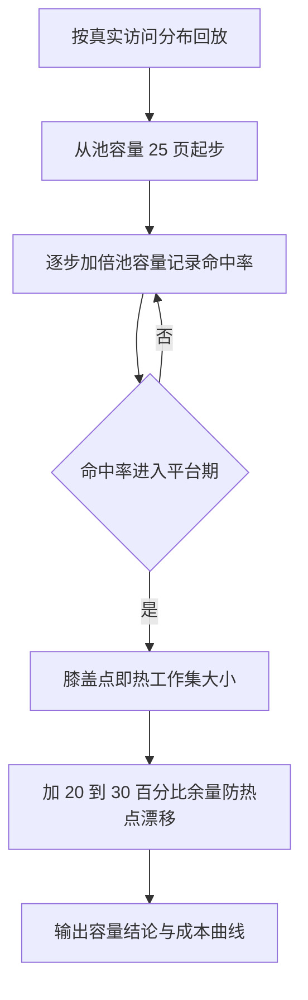

### Q2240 · 缓冲池容量与命中率: 找到拐点再花钱

> 难度:★★★★ | 标签:容量, 缓冲池

**问**:内存那么便宜,把缓冲池配成数据总量一样大不就好了?

**答**:不必也不常可行,正确目标是"覆盖热工作集"而不是全量数据:访问分布高度倾斜(Zipf)时,很小比例的页承载了大部分请求,缓冲池达到热工作集大小后命中率进入平台,再加内存收益骤减。实测方法:按真实访问分布回放,扫描一组池容量画命中率曲线,曲线的"膝盖点"就是性价比配置;再加 20-30% 余量应对热点漂移。两个约束别忘了:缓冲池过大引发更长的 fork/快照时间(RDB、备份)与更重的启动预热;命中率低也不一定是池小,可能是全表扫描把热页冲出(扫描污染),那是查询问题。容量规划的输出是一句话:热工作集多大、当前池多大、离膝盖点多远。

```python
# file: code/04_数据库与缓存/q2240_buffer_pool_hit.py
"""缓冲池容量与命中率: Zipf 访问下找拐点"""
import random
from collections import OrderedDict

def simulate(keys, size):
    pool = OrderedDict()
    hit = 0
    for k in keys:
        if k in pool:
            pool.move_to_end(k)
            hit += 1
        else:
            if len(pool) >= size:
                pool.popitem(last=False)
            pool[k] = True
    return hit / len(keys)

random.seed(9)
weights = [1.0 / (i + 1) for i in range(1000)]      # 1000 个页 Zipf 倾斜
keys = random.choices(range(1000), weights=weights, k=30000)
sizes = [25, 50, 100, 200, 400, 800]
print("缓冲池页数 -> 命中率")
for s in sizes:
    print("%6d   ->  %5.1f%%" % (s, simulate(keys, s) * 100))
print("命中率在接近热工作集时出现膝盖点, 之后加内存收益骤减, 再留余量防热点漂移")
```

**追问**:
- 全表扫描为什么是"污染"?—— 扫描把大量冷页灌进 LRU,挤掉真热页;生产用 LRU 尾部隔离(midpoint insertion)或把扫描会话放进独立低优先级池。
- 曲线怎么采集?—— 从慢日志或页统计还原访问序列,或压测回放;Redis 场景用 info 的 keyspace 命中率对 maxmemory 做梯度压测同理。

---



---
