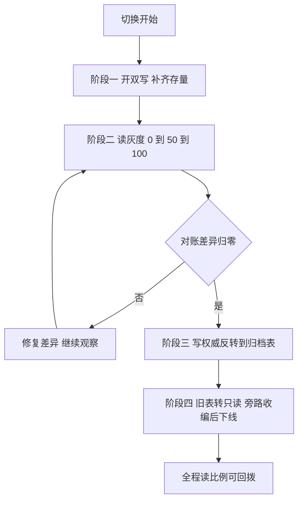

### Q2245 · 归档表切换的双写窗口: 写两份 读灰度 对账收尾

> 难度:★★★★ | 标签:归档, 切换

**问**:把订单读路径切到归档表,怎么切才不出事?

**答**:双写窗口四阶段。第一阶段开双写:新旧表同写(同事务或本地消息表保证),归档表在窗口内补齐存量,差异由对账任务发现;第二阶段读灰度:读路径按比例(0% → 50% → 100%)切到归档表,每档观察错误率与延迟,回滚只需把比例拨回 0;第三阶段反转写权威:写路径改为只写归档表,旧表停写但保留,此时归档表是唯一权威副本;第四阶段收尾:对账归零、观察一个业务周期后,旧表转只读归档再下线。两个易漏点:读灰度期间两条路径结果必须一致,靠对账而非"应该一致";停写旧表前要确认没有旁路任务还在写它(定时任务、报表、脚本),旁路漏改是切换后数据分叉的头号来源。

```python
# file: code/04_数据库与缓存/q2245_archive_switch.py
"""归档表切换的双写窗口: 双写 -> 读灰度 -> 反转写权威 -> 收尾"""
import random
import sqlite3

conn = sqlite3.connect(":memory:")
c = conn.cursor()
c.execute("CREATE TABLE orders_hot(id INTEGER PRIMARY KEY, amt REAL)")
c.execute("CREATE TABLE orders_archive(id INTEGER PRIMARY KEY, amt REAL)")
random.seed(2)

class Cutover:
    def __init__(self):
        self.dual_write = True
        self.read_archive_pct = 0

    def write_order(self, oid, amt):
        if self.dual_write:
            c.execute("INSERT OR REPLACE INTO orders_hot VALUES(?,?)", (oid, amt))
            c.execute("INSERT OR REPLACE INTO orders_archive VALUES(?,?)", (oid, amt))
        else:
            c.execute("INSERT OR REPLACE INTO orders_archive VALUES(?,?)", (oid, amt))

    def read_order(self, oid):
        if random.random() * 100 < self.read_archive_pct:
            return c.execute("SELECT amt FROM orders_archive WHERE id=?", (oid,)).fetchone()
        return c.execute("SELECT amt FROM orders_hot WHERE id=?", (oid,)).fetchone()

ct = Cutover()
for oid in range(1, 101):
    ct.write_order(oid, float(oid))

def recon():
    a = dict(c.execute("SELECT id, amt FROM orders_hot"))
    b = dict(c.execute("SELECT id, amt FROM orders_archive"))
    return len(a), len(b), sum(1 for k in a if a[k] != b.get(k))

print("双写后对账 hot=%d 行 archive=%d 行 差异=%d" % recon())
ct.read_archive_pct = 50
reads = [ct.read_order(1)[0] for _ in range(100)]
print("读灰度 50%% 两条路径结果一致:", all(r == 1.0 for r in reads))
ct.read_archive_pct = 100
ct.dual_write = False
for oid in range(101, 121):
    ct.write_order(oid, float(oid))
print("写权威反转后 hot 停在 %d 行, 新数据只进 archive=%d 行" % (
    c.execute("SELECT count(*) FROM orders_hot").fetchone()[0],
    c.execute("SELECT count(*) FROM orders_archive").fetchone()[0]))
print("窗口期纪律: 双写保一致 读灰度可回滚 对账归零才停写旧表, 旁路写入要提前收编")
```

**追问**:
- 双写失败了怎么办?—— 写归档失败要能让主写失败或落补偿队列,窗口期归档表允许短暂落后但不允许静默丢,对账兜底修复。
- 历史存量怎么补?—— 按主键分段批量回填带断点,回填与增量双写并行,靠幂等 upsert 消重,回填完成才允许读灰度上线。


