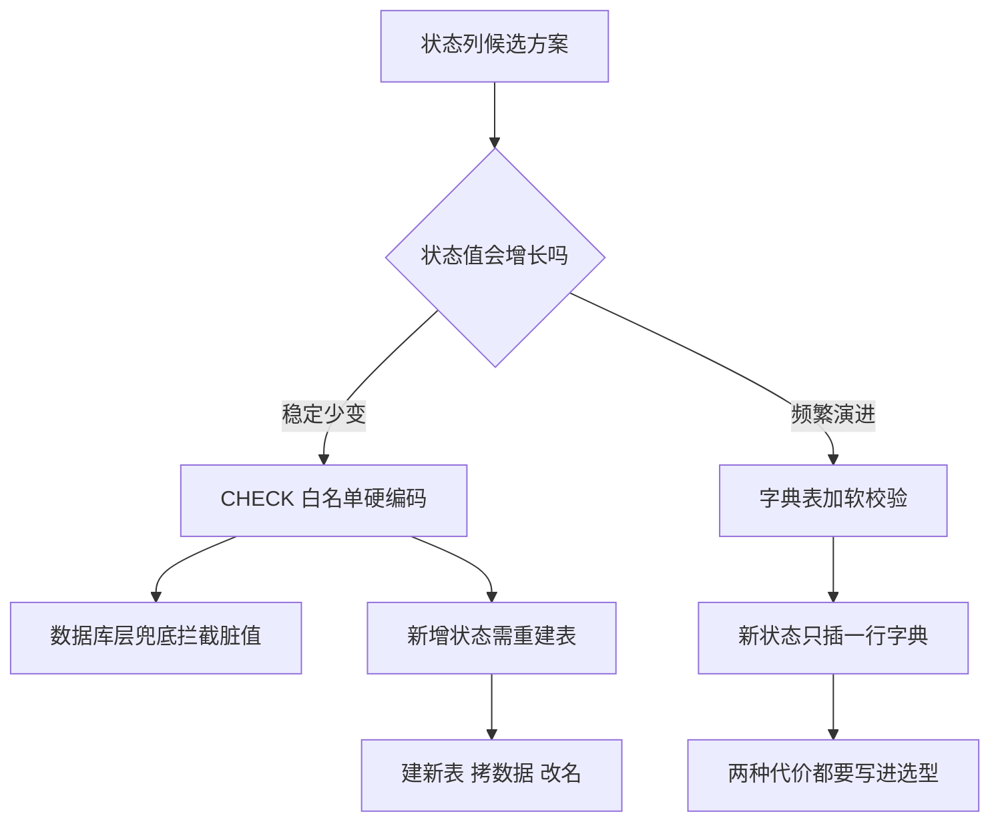

### Q2475 · 状态列的 CHECK 白名单与迁移代价

> 难度:★★★☆ | 标签:约束, 状态机

**问**:状态字段直接用 VARCHAR 随便写,怎么用数据库层守住?又有什么代价?

**答**:用 CHECK 约束做白名单:`CHECK (state IN ('pending','running','done','failed'))`,应用层失守(拼错、绕过 ORM 直写)时数据库照样拦截脏值。代价在演进:SQLite 不支持 ALTER 修改 CHECK,新增一个状态值必须走"建新表-拷数据-改名"的重建流程;MySQL 里改 CHECK 同样要改表定义。所以选型标准是:低频稳定的状态集(订单生命周期)值得 CHECK 硬编码,高频扩展的枚举(标签、类目)放字典表加软校验。两层可以并用:CHECK 兜住核心生命周期,字典表管可扩展属性。

```python
# file: code/04_数据库与缓存/q2475_check_state_whitelist.py
"""状态列的 CHECK 白名单: 数据库层兜底, 以及新增状态要重建表的迁移代价"""
import sqlite3

conn = sqlite3.connect(":memory:")
c = conn.cursor()
c.execute("""CREATE TABLE tasks (
    id INTEGER PRIMARY KEY,
    state TEXT NOT NULL DEFAULT 'pending'
    CHECK (state IN ('pending', 'running', 'done', 'failed'))
)""")
c.execute("INSERT INTO tasks(state) VALUES('pending'), ('running'), ('done')")

# 白名单拦截非法状态, 应用层失守也有防线
try:
    c.execute("INSERT INTO tasks(state) VALUES('runing')")   # 手滑的拼写
except sqlite3.IntegrityError as e:
    print("非法状态被 CHECK 拦截: %s" % e)

# 迁移代价: SQLite 不支持 ALTER 修改 CHECK, 新增状态必须重建表
try:
    c.execute("ALTER TABLE tasks ADD CONSTRAINT dummy CHECK (1=1)")
except sqlite3.OperationalError as e:
    print("ALTER 改 CHECK 不可行: %s" % e)

print("-- 走重建表流程: 建新表 -> 拷数据 -> 改名 --")
c.execute("""CREATE TABLE tasks_new (
    id INTEGER PRIMARY KEY,
    state TEXT NOT NULL DEFAULT 'pending'
    CHECK (state IN ('pending', 'running', 'done', 'failed', 'cancelled'))
)""")
c.execute("INSERT INTO tasks_new SELECT id, state FROM tasks")
c.execute("DROP TABLE tasks")
c.execute("ALTER TABLE tasks_new RENAME TO tasks")
c.execute("INSERT INTO tasks(state) VALUES('cancelled')")
print("重建后状态集合:", [r[0] for r in c.execute("SELECT DISTINCT state FROM tasks ORDER BY state")])

print("结论: CHECK 白名单防脏数据有效, 但枚举演进要付出重建表代价,")
print("      高频新增的状态值放字典表, 低频稳定的状态值才值得 CHECK 硬编码")
```

**追问**:
- CHECK 与 ORM 层枚举怎么分工?—— ORM 枚举管开发期拼写与流转逻辑,CHECK 管运行期兜底,两边白名单要进 CI 比对。
- 大表重建 CHECK 的锁影响?—— 重建等于全表读写,必须低峰窗口或在线改表工具,见前面大表 DDL 相关题。



---
