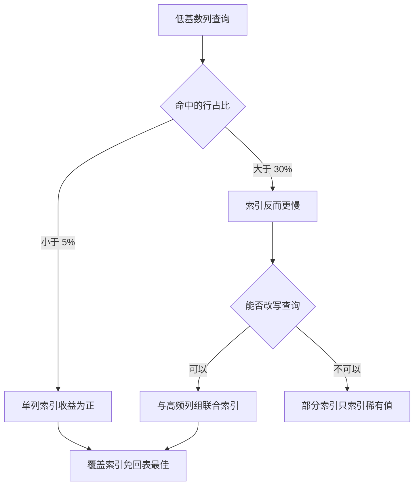

### Q2480 · 低基数列的单列索引: 选择性决定成败

> 难度:★★★☆ | 标签:索引, 选择性

**问**:status 只有三个值,给它建索引有用吗?

**答**:取决于查询命中的行占比,不是列的基数字本身:命中 1% 的稀有值,索引是数倍收益;命中 90% 的常见值,非覆盖索引意味着几十万次随机回表,实测比顺序全表扫描还慢。所以低基数列的索引规则有三条:单列索引只服务稀有值查询;与高频条件组成联合索引(如 status+created_at)让范围过滤受益;或用部分索引只索引稀有值,体积还小。反过来说,删掉一个"从未被稀有值查询用到"的低基数单列索引,写入立刻受益——它纯粹是写放大。

```python
# file: code/04_数据库与缓存/q2480_low_cardinality_index.py
"""低基数列的单列索引: 选择性决定它是加速器还是累赘"""
import sqlite3
import time

conn = sqlite3.connect(":memory:")
c = conn.cursor()
c.execute("CREATE TABLE t (id INTEGER PRIMARY KEY, status TEXT, payload TEXT)")
# 90% 是 a, 9% 是 b, 1% 是 c
rows = []
for i in range(1, 50001):
    s = 'a' if i % 10 < 9 else ('b' if i % 100 < 95 else 'c')
    rows.append((i, s, "p%d" % i))
c.executemany("INSERT INTO t VALUES(?,?,?)", rows)
c.execute("CREATE INDEX idx_status ON t(status)")
c.execute("ANALYZE")

def timed(sql, args):
    t0 = time.perf_counter()
    data = c.execute(sql, args).fetchall()
    return len(data), (time.perf_counter() - t0) * 1000

# 同一条查询, 两种选择性, 有索引与无索引各跑一次
for v in ('c', 'a'):
    n_with, ms_with = timed("SELECT * FROM t WHERE status = ?", (v,))
    c.execute("DROP INDEX idx_status")
    c.execute("ANALYZE")
    n_wo, ms_wo = timed("SELECT * FROM t WHERE status = ?", (v,))
    c.execute("CREATE INDEX idx_status ON t(status)")
    c.execute("ANALYZE")
    verdict = "索引赢" if ms_with < ms_wo else "索引反而慢"
    print("status='%s' 命中 %5d 行: 有索引 %6.1f ms | 无索引 %6.1f ms -> %s"
          % (v, n_with, ms_with, ms_wo, verdict))

# 出路: 低基数列不单独出门, 与高频条件组成联合索引才有效
c.execute("CREATE INDEX idx_status_payload ON t(status, payload)")
plan = " | ".join(r[3] for r in c.execute(
    "EXPLAIN QUERY PLAN SELECT * FROM t WHERE status='c' AND payload LIKE 'p4%'"))
print("组合索引下的计划: %s" % plan)
print("结论: 选择性 1% 的值走索引是数倍收益, 90% 的值走非覆盖索引是数倍亏损,")
print("      低基数列要么进联合索引, 要么建部分索引只索引稀有值")
```

**追问**:
- 优化器为什么不自动弃用低选择性索引?—— 成本估算依赖统计信息,估算偏差加上覆盖扫描的收益,使它常常仍选索引;要以实测为准。
- 联合索引里低基数列放第一列还是第二列?—— 等值条件在前、范围在后;低基数等值列放前面仍能命中,后面列才承担真正的过滤。



---
