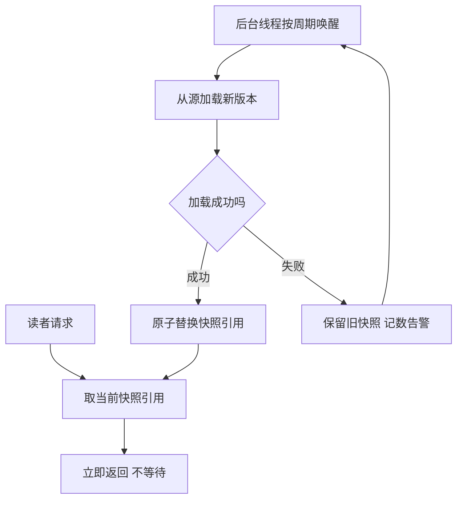

### Q2485 · 读多写多本地缓存的刷新: 后台定时替换快照

> 难度:★★★☆ | 标签:本地缓存, 刷新

**问**:一份读多写多的配置数据放进进程内缓存,刷新时怎么避免读者被拖慢?

**答**:核心是把"刷新"从读者身上挪走:读者永远只碰现成的快照引用,后台线程按周期从源加载数据,加载完成后原子替换引用(整体换新字典,不原地改)。对比实测:读者自刷新模式下,撞上过期的那次读要扛 15ms 的加载耗时;后台定时刷新模式下读者最大延迟趋近于零,代价是数据允许"一个周期内的旧"。配套细节:快照替换后旧引用由读者自然用完,不需要锁;加载失败保留旧快照并计数告警;写多到一定频率就该换失效广播模式而不是定时刷新。

```python
# file: code/04_数据库与缓存/q2485_local_refresh.py
"""读多写多本地缓存的刷新策略: 后台定时刷新让读者永远不等"""
import threading
import time

# 模拟一个慢配置源: 读取要 15 ms
SOURCE = {"rate": 1.0, "version": 1}

def load_from_source():
    time.sleep(0.015)
    return dict(SOURCE)

INTERVAL = 0.05
READS = 30

def run_blocking_mode():
    cache = load_from_source()
    loaded_at = time.monotonic()
    max_lat = 0.0
    for i in range(READS):
        if time.monotonic() - loaded_at > INTERVAL:      # 读者自己发现过期, 自己扛刷新
            cache = load_from_source()
            loaded_at = time.monotonic()
        t0 = time.monotonic()
        _ = cache["rate"]                                 # 读操作本体
        max_lat = max(max_lat, time.monotonic() - t0)
    return max_lat

def run_background_mode():
    box = {"cache": load_from_source()}
    stop = threading.Event()

    def refresher():                                      # 后台线程独扛刷新
        while not stop.is_set():
            time.sleep(INTERVAL)
            box["cache"] = load_from_source()             # 原子替换引用, 读者无感知
    th = threading.Thread(target=refresher)
    th.start()
    max_lat = 0.0
    for i in range(READS):
        t0 = time.monotonic()
        _ = box["cache"]["rate"]                          # 永远只碰现成的快照
        max_lat = max(max_lat, time.monotonic() - t0)
    stop.set()
    th.join()
    return max_lat

lat_sync = run_blocking_mode()
lat_bg = run_background_mode()
print("读多写多配置: 读者自刷新模式最大读延迟 %.1f ms" % (lat_sync * 1000))
print("读多写多配置: 后台定时刷新模式最大读延迟 %.3f ms" % (lat_bg * 1000))
print("结论: 读多写少的数据值得养一个后台刷新线程, 用'秒级旧值'换'读者零阻塞';")
print("      刷新用整体替换引用而不是原地改字典, 读者拿到的永远是完整快照")
```

**追问**:
- 为什么替换引用而不是原地更新字典?—— 原地改会让读者看到半新半旧的中间态;不可变快照 + 引用替换天然线程安全。
- 多个实例怎么感知"配置变了"?—— 定时刷新兜底,缩短感知延迟用版本号轮询或失效广播(见广播丢消息兜底题)。



---
