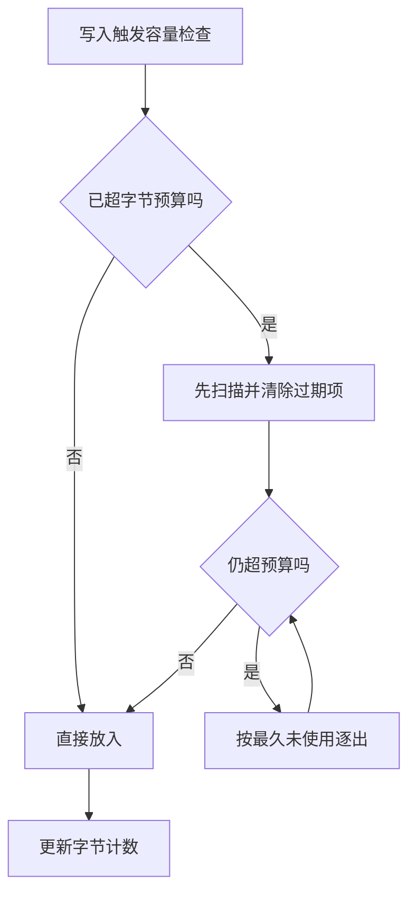

### Q2490 · 字节预算下的驱逐顺序: 过期优先再 LRU

> 难度:★★★★ | 标签:本地缓存, 驱逐

**问**:本地缓存要按"字节预算"而不是条数控制容量,驱逐顺序怎么定?

**答**:正确顺序是两级:写入触发容量检查后,先清除所有已过期项——它们本来就无价值,无论新旧;仍超预算,再按最久未使用(LRU)逐出,直到回落到水位内。常见实现事故是把顺序反过来:先逐出热点未过期项,命中率先跳水;或者驱逐时忘了同步扣减字节计数,导致 used 虚高、缓存假满。实现要点:访问即 move_to_end 晋升、过期用惰性判定(get 时检查)、驱逐循环必须有终态保证(预算一定可满足)。字节预算比条数预算更贴近内存真相,代价是每次 set 都要维护计数。

```python
# file: code/04_数据库与缓存/q2490_byte_budget_eviction.py
"""带字节预算的本地缓存驱逐: 先清过期, 再逐出 LRU"""
import collections

class BudgetCache:
    def __init__(self, budget):
        self.budget = budget
        self.used = 0
        self.entries = collections.OrderedDict()   # key -> [value, size, expire_at]
        self.now = 0

    def get(self, key):
        item = self.entries.get(key)
        if item is None:
            return None
        value, size, expire_at = item
        if self.now >= expire_at:                  # 惰性过期
            del self.entries[key]
            self.used -= size
            return None
        self.entries.move_to_end(key)              # 访问即晋升为最近使用
        return value

    def set(self, key, value, size, ttl):
        self.now += 1
        expire_at = self.now + ttl
        if key in self.entries:
            self.used -= self.entries[key][1]
            del self.entries[key]
        self.entries[key] = [value, size, expire_at]
        self.used += size
        self._evict()

    def _evict(self):
        # 第一优先级: 过期项先走, 无论新旧
        expired = [(k, s) for k, (_, s, e) in self.entries.items() if self.now >= e]
        for k, s in expired:
            del self.entries[k]
            self.used -= s
        # 第二优先级: 仍超预算, 按最久未使用逐出
        while self.used > self.budget and self.entries:
            k, (_, s, _) = self.entries.popitem(last=False)
            self.used -= s
            print("  超预算, LRU 逐出 %s (回收 %d 字节)" % (k, s))

cache = BudgetCache(100)
cache.set("a", "A" * 30, 30, ttl=1)
cache.set("b", "B" * 30, 30, ttl=99)
cache.now += 5                                     # 时间前进, a 已过期
cache.set("c", "C" * 30, 30, ttl=99)               # 触发驱逐: 过期的 a 先被惰性清掉
print("过期优先后: 键=%s used=%d" % (list(cache.entries), cache.used))
assert "a" not in cache.entries

cache.set("d", "D" * 50, 50, ttl=99)               # 再塞大的, 超出预算
print("最终: 键=%s used=%d/%d" % (list(cache.entries), cache.used, cache.budget))
print("结论: 字节预算下的正确驱逐顺序是'过期项 -> LRU',")
print("      先逐出热点未过期项是最常见的实现事故, 会让命中率当场跳水")
```

**追问**:
- LRU 和 LFU 在这里怎么选?—— 偶发批量扫描会污染 LRU,W-TinyLFU/频次衰减更抗扫描;实现成本高时先上 LRU 再观测。
- 驱逐应不应该批量做?—— 应,水位到 90% 就批量驱逐到 70%,摊平驱逐毛刺,避免每次 set 都触发长循环。



---
