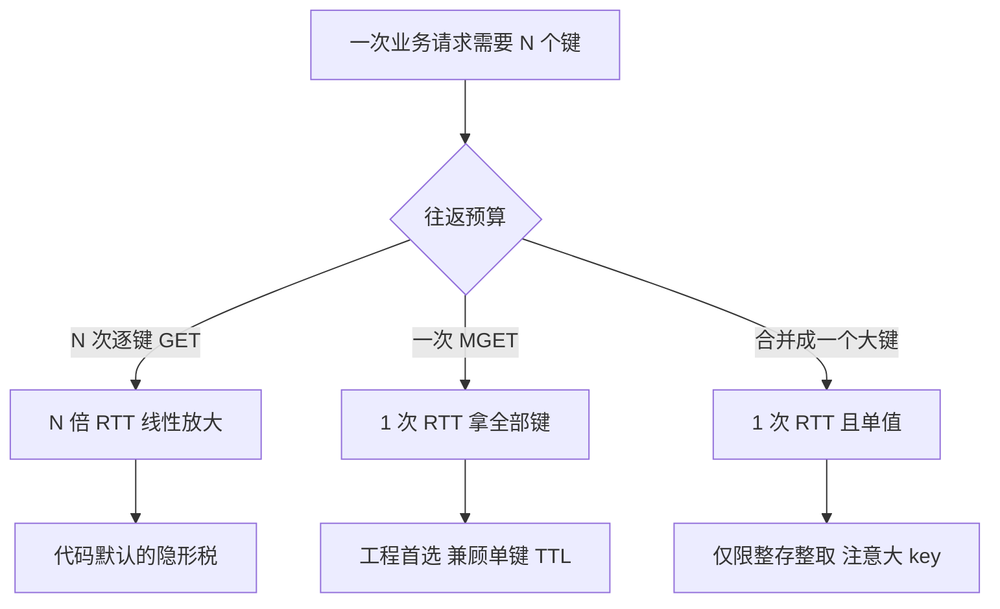

### Q2495 · 缓存读放大: 一次请求 20 次往返的治理

> 难度:★★★☆ | 标签:缓存, 性能

**问**:页面一次请求打 20 次缓存命令,网络开销怎么算怎么治?

**答**:读放大 = 命令次数 × RTT。逐键 GET 是 20 次往返,20ms 起步,这笔"隐形税"藏在代码里;治理有三档:MGET 一次往返拿全部键(首选,保留单键 TTL 与独立过期);字段合并成一个大 hash(1 次往返,但要警惕大 key——更新任一字段重写整个值,失去单字段 TTL);以及按业务对象组织键,把"总是整存整取"的属性收进一个值。判断标准:字段总是同生共死用合并键,字段有独立生命周期用 MGET。逐键循环只允许出现在低频后台逻辑里。

```python
# file: code/04_数据库与缓存/q2495_read_amplification.py
"""缓存读放大: 一次请求 20 次往返的治理"""
import time

RTT = 0.001                                       # 模拟一次缓存往返 1 ms

def rtt(n=1):
    time.sleep(RTT * n)
    return n * RTT * 1000

# 方式一: 逐键 GET, 一次页面请求 20 次往返
fields = ["f%d" % i for i in range(20)]
t0 = time.perf_counter()
ms_naive = rtt(len(fields))
per_key_bytes = sum(30 for _ in fields)           # 每键 30 字节
print("逐键 GET:   %2d 次往返, 传输 %3d 字节, 耗时 %.1f ms" % (len(fields), per_key_bytes, ms_naive))

# 方式二: MGET 一次往返取全部键
t0 = time.perf_counter()
ms_mget = rtt(1)
print("MGET 批量:   1 次往返, 传输 %3d 字节, 耗时 %.1f ms" % (per_key_bytes, ms_mget))

# 方式三: 字段合并成一个大 hash 键, 一次往返 + 一次 HGETALL
merged_bytes = per_key_bytes + len(fields) * 8    # 字段名开销
t0 = time.perf_counter()
ms_hash = rtt(1)
print("合并大键:    1 次往返, 传输 %3d 字节, 耗时 %.1f ms" % (merged_bytes, ms_hash))

print("代价对账: 逐键方式把 20 倍 RTT 藏在了代码里; 合并键最快但制造大 key,")
print("      更新任一字段要重写整个值且失去单字段 TTL;")
print("      工程默认选 MGET, 合并键只用于字段总是整取整存的聚合对象")
```

**追问**:
- Pipeline 和 MGET 的区别?—— Pipeline 仍是 N 条命令一次网络发送,省的是往返;MGET 是一条命令,还省协议开销,同槽位集群下注意跨槽限制。
- 跨槽的大 hash 怎么迁移?—— 合并键绑死一个槽,扩容时按键迁移;字段级拆分(分段 hash)是迁移粒度与大 key 的折中。



---
