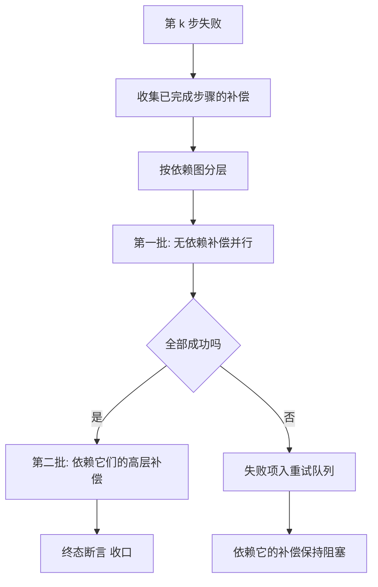

### Q2500 · 补偿的顺序与依赖图: 能并行才并行

> 难度:★★★★ | 标签:SAGA, 补偿

**问**:跨服务流程第 4 步失败,前 3 步的补偿是"严格倒序"执行吗?

**答**:倒序是常见形态,不是铁律;铁律是补偿的依赖图。补偿之间有依赖的必须等(关单要等积分返还、优惠券释放都完成),没有依赖的应该并行(撤销出库、返积分、放优惠券互不等待),分层执行能显著缩短补偿窗口。实测:四个补偿按依赖图分成两批,第一批三个并行,第二批一个收尾。另外补偿自身会失败——失败项进重试队列,依赖它的补偿保持阻塞,直到重试成功;补偿链不能因为一次抖动就停摆。每个补偿都必须幂等:重试是常态,重复执行效果不变是底线。

```python
# file: code/04_数据库与缓存/q2500_compensation_order.py
"""补偿的顺序与依赖图: 能并行的并行, 该逆序的逆序"""
import collections

# 正向步骤 -> 补偿动作, 以及补偿之间的依赖 (前者必须等后者完成)
compensations = {
    "cancel_shipment":   set(),        # 撤销出库: 无依赖
    "refund_points":     set(),        # 返还积分: 无依赖
    "restore_coupon":    set(),        # 释放优惠券: 无依赖
    "cancel_order":      {"refund_points", "restore_coupon"},   # 关单必须等钱和券都回来
}
executed_forward = ["create_order", "deduct_points", "lock_coupon", "create_shipment"]
forward_to_comp = {
    "create_order": "cancel_order",
    "deduct_points": "refund_points",
    "lock_coupon": "restore_coupon",
    "create_shipment": "cancel_shipment",
}

def topo_batches(graph):
    indeg = {k: len(v) for k, v in graph.items()}
    dependents = collections.defaultdict(list)
    for k, deps in graph.items():
        for d in deps:
            dependents[d].append(k)
    ready = [k for k, d in indeg.items() if d == 0]
    batches = []
    while ready:
        batches.append(sorted(ready))              # 一批可并行
        nxt = []
        for done in ready:
            for nxt_node in dependents[done]:
                indeg[nxt_node] -= 1
                if indeg[nxt_node] == 0:
                    nxt.append(nxt_node)
        ready = nxt
    return batches

batches = topo_batches(compensations)
print("正向已执行:", executed_forward)
print("失败于第 4 步, 补偿按依赖分层执行:")
for i, batch in enumerate(batches, 1):
    print("  第 %d 批 (可并行): %s" % (i, batch))
assert batches[1] == ["cancel_order"]

# 补偿自身失败: 重试队列兜底, 不能让补偿链停摆
retry_queue = []
ok = []
for comp in batches[0]:
    if comp == "restore_coupon":
        retry_queue.append(comp)                   # 模拟券服务抖动失败
    else:
        ok.append(comp)
print("第 1 批结果: 成功 %s, 失败入重试队列 %s (依赖它的 cancel_order 被阻塞)"
      % (ok, retry_queue))
print("结论: 补偿顺序由依赖图而不是直觉决定, 逆序只是拓扑序的常见形态;")
print("      无依赖的补偿并行跑缩短窗口, 补偿失败走重试队列, 上游依赖保持阻塞直到它成功")
```

**追问**:
- 补偿依赖从哪来?—— 从正向步骤的资源依赖反推:谁消费了谁的结果,撤销就要反着等;最好把依赖写进编排定义而不是靠人记。
- 并行补偿会引入新问题吗?—— 会,总补偿时长由最慢者决定,还要处理"部分成功"的中间态可见性,状态机要标明补偿中。



---
