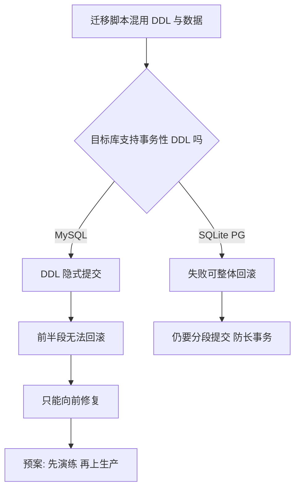

### Q2505 · 事务中的 DDL: 事务性 DDL 与隐式提交

> 难度:★★★☆ | 标签:DDL, 迁移

**问**:事务里能建表吗?回滚时表会消失吗?

**答**:分库而论。SQLite 和 PostgreSQL 的 DDL 是事务性的:CREATE/DROP 与数据同事务提交、同事务回滚——实测事务里建表再 DROP 原表,ROLLBACK 后一切复原,迁移工具正是靠这个实现"失败即整体回滚"。MySQL 的 DDL 会隐式提交:同一个事务里"改表+改数据",改表那一刻前面的数据变更已被提交,后面再失败也无法回滚前半段,只能向前修复。通用纪律:迁移脚本按"可回滚单元"切分,DDL 与 DML 的混用要评估目标库语义;SQLite 这类事务性 DDL 仍要注意长事务代价。

```python
# file: code/04_数据库与缓存/q2505_ddl_in_transaction.py
"""事务中的 DDL: SQLite 里可回滚, MySQL 里隐式提交"""
import sqlite3
import tempfile
import os

db = os.path.join(tempfile.mkdtemp(), "ddl.db")
conn = sqlite3.connect(db, isolation_level=None)
c = conn.cursor()
c.execute("CREATE TABLE data (id INTEGER PRIMARY KEY, v TEXT)")
c.execute("INSERT INTO data(v) VALUES('a'), ('b')")

# SQLite: DDL 也是事务性语句, 可以和数据一起回滚
c.execute("BEGIN")
c.execute("CREATE TABLE tmp_stage (id INTEGER PRIMARY KEY, v TEXT)")
c.execute("INSERT INTO tmp_stage SELECT id, v FROM data")
c.execute("DROP TABLE data")                      # 迁移脚本里常见的危险动作
tables = [r[0] for r in c.execute(
    "SELECT name FROM sqlite_master WHERE type='table' ORDER BY name")]
print("事务内建了 tmp_stage 又 DROP 了 data, 此刻表清单: %s" % tables)
c.execute("ROLLBACK")
tables = [r[0] for r in c.execute(
    "SELECT name FROM sqlite_master WHERE type='table' ORDER BY name")]
n = c.execute("SELECT COUNT(*) FROM data").fetchone()[0]
print("ROLLBACK 之后表清单: %s, data 行数 %d  <- DDL 与数据一起被回滚" % (tables, n))

# 但要小心: 连接默认的隐式提交行为因驱动而异, 手工混用容易踩出意外提交点
c.execute("BEGIN")
c.execute("INSERT INTO data(v) VALUES('c')")
c.execute("CREATE TABLE log (id INTEGER PRIMARY KEY, msg TEXT)")
c.execute("COMMIT")
tables = [r[0] for r in c.execute(
    "SELECT name FROM sqlite_master WHERE type='table' ORDER BY name")]
print("DDL 与 DML 同事务一起提交: %s, data 行数 %d" % (
    tables, c.execute("SELECT COUNT(*) FROM data").fetchone()[0]))
print("结论: 迁移工具喜欢 SQLite/PG 这类事务性 DDL——失败即整体回滚;")
print("      MySQL 的 DDL 会隐式提交, '改表+改数据'混在一个事务里是经典事故源")
conn.close()
```

**追问**:
- 事务性 DDL 有代价吗?—— 有:长事务里的 DDL 同样挡 checkpoint/purge;PG 的 DDL 还会锁系统目录,并发 DDL 容易排队。
- MySQL 8 有改善吗?—— 部分_ddl 支持原子(崩溃时不半截),但仍不参与事务回滚,"隐式提交"语义没变。



---
