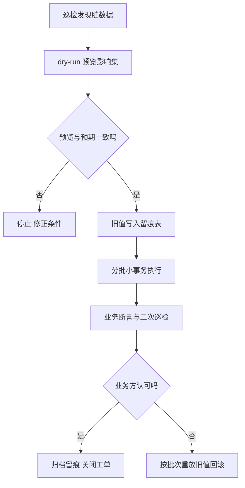

### Q2510 · 订正的快照留痕: 旧值入档一键回滚

> 难度:★★★☆ | 标签:订正, 回滚

**问**:订正跑完了,业务方说改错了,怎么撤?

**答**:靠订正前的快照留痕:执行 UPDATE 之前,把每一行、每一列的旧值连同批次号写进 fix_log(应用级 undo log);要回滚就按批次重放旧值,撤完清掉该批次留痕。实测:冻结 2 个账户的订正,留痕 4 条(每行两列),回滚后账户完整还原。留痕的本质是把"回滚能力"从数据库层(事务回滚,提交即失效)搬到应用层(提交后依然可逆),覆盖了绝大多数 UPDATE 类订正事故。边界要说清:它救不了 DELETE 行恢复——那要靠备份与 binlog;留痕表本身也要有清理策略,别变成新的膨胀源。

```python
# file: code/04_数据库与缓存/q2510_fix_snapshot_rollback.py
"""订正的快照留痕: 旧值入档, 一键回滚"""
import sqlite3
import time

conn = sqlite3.connect(":memory:")
c = conn.cursor()
c.execute("CREATE TABLE accounts (id INTEGER PRIMARY KEY, status TEXT, balance INTEGER)")
c.execute("""CREATE TABLE fix_log (
    batch_id TEXT, tbl TEXT, pk INTEGER, col TEXT, old TEXT, new TEXT, at INTEGER)""")
c.executemany("INSERT INTO accounts VALUES(?,?,?)",
              [(1, "active", 100), (2, "active", 200), (3, "frozen", 300)])
conn.commit()

def apply_fix(batch, where_sql, set_sql, args):
    rows = c.execute("SELECT id, status, balance FROM accounts WHERE " + where_sql,
                     args).fetchall()
    now = int(time.time())
    c.execute("BEGIN")
    for rid, st, bal in rows:                      # 先留痕: 记录会被改的每一列旧值
        c.execute("INSERT INTO fix_log VALUES(?,?,?,?,?,?,?)",
                  (batch, "accounts", rid, "status", st, None, now))
        c.execute("INSERT INTO fix_log VALUES(?,?,?,?,?,?,?)",
                  (batch, "accounts", rid, "balance", str(bal), None, now))
    c.execute("UPDATE accounts SET " + set_sql + " WHERE " + where_sql, args)
    c.execute("UPDATE fix_log SET new = 'written' WHERE batch_id = ? AND new IS NULL", (batch,))
    c.execute("COMMIT")
    return len(rows)

batch = "fix-20261105-01"
n = apply_fix(batch, "status = 'active'", "status = 'frozen', balance = 0", ())
print("订正 %s: 冻结 %d 个账户, 每列旧值已入档" % (batch, n))

def rollback(batch):
    c.execute("BEGIN")
    for pk, col, old in c.execute(
            "SELECT pk, col, old FROM fix_log WHERE batch_id = ?", (batch,)).fetchall():
        c.execute("UPDATE accounts SET %s = ? WHERE id = ?" % col, (old, pk))
    c.execute("DELETE FROM fix_log WHERE batch_id = ?", (batch,))
    c.execute("COMMIT")

rollback(batch)
print("回滚后账户:", c.execute("SELECT id, status, balance FROM accounts ORDER BY id").fetchall())
assert c.execute("SELECT COUNT(*) FROM accounts WHERE status='active'").fetchone()[0] == 2
print("结论: 订正留痕的本质是'应用级 undo log', 按批次组织, 回滚是重放旧值;")
print("      它救不了删除行的恢复 (那要靠备份), 但覆盖了绝大多数 UPDATE 类订正事故")
```

**追问**:
- 留痕和 binlog 闪回什么关系?—— binlog 闪回是库层通用 undo,依赖日志保留与解析工具;留痕是应用层显式保险,跨库可用且语义明确,二者互补。
- 订正后又有正常业务写入,回滚会覆盖吗?—— 会,这就是留痕必须配"订正后核对窗口"的原因:确认无新写入或只回滚明确批次。



---
