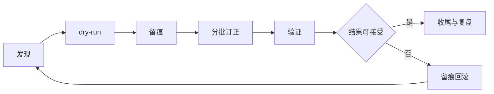

### Q2515 · 综合案例: 一次字段订正的完整治理链

> 难度:★★★★★ | 标签:综合, 数据治理

**问**:订单表里混进了一批负金额脏数据,从发现到收尾,完整的治理链是什么?

**答**:六环,缺一环就是赌博。发现:巡检规则(amount < 0)报出脏行清单;dry-run:预览影响集并与巡检结果对账,两份清单必须一致;留痕:执行前把每行旧值连同批次号写入 fix_log;分批订正:每批一个独立小事务,可断点可观测;验证:业务断言(无残留负金额、总行数不变、留痕数与订正数一致)加二次巡检;回滚通道:业务方裁定订正过宽时,按批次重放旧值,全流程可逆。实测走完整链:8 行脏数据,分 4 批订正,验证通过,回滚演示还原。这套链的价值不在单步,而在"每一步都有对照物":巡检对 dry-run,dry-run 对 rowcount,订正对留痕,留痕对回滚。

```python
# file: code/04_数据库与缓存/q2515_fix_pipeline.py
"""综合案例: 一次字段订正的完整治理链"""
import sqlite3

conn = sqlite3.connect(":memory:")
c = conn.cursor()
c.execute("CREATE TABLE orders (id INTEGER PRIMARY KEY, amount INTEGER NOT NULL)")
c.execute("""CREATE TABLE fix_log (batch_id TEXT, pk INTEGER, col TEXT,
             old INTEGER, new INTEGER)""")
seed = [100, -50, 200, -30, 400, -10, 500, -70]
c.executemany("INSERT INTO orders(amount) VALUES(?)", [(v,) for v in seed])
conn.commit()

def detect():
    return c.execute("SELECT id, amount FROM orders WHERE amount < 0 ORDER BY id").fetchall()

# 1) 发现: 巡检报出脏数据
dirty = detect()
print("[1 发现] 负金额行: %s" % dirty)

# 2) dry-run: 预览影响集, 与发现结果对账
preview = c.execute("SELECT id, amount FROM orders WHERE amount < 0").fetchall()
assert preview == dirty
print("[2 dry-run] 预览 %d 行, 与巡检一致" % len(preview))

# 3) 留痕 + 分批订正: 每批一个事务, 旧值入 fix_log
BATCH = 2
batch_id = "fix-neg-amount-01"
ids = [r[0] for r in preview]
for i in range(0, len(ids), BATCH):
    window = ids[i:i + BATCH]
    c.execute("BEGIN")
    for rid in window:
        old = c.execute("SELECT amount FROM orders WHERE id=?", (rid,)).fetchone()[0]
        c.execute("INSERT INTO fix_log VALUES(?,?,?,?,?)", (batch_id, rid, "amount", old, 0))
    c.execute("UPDATE orders SET amount=0 WHERE id IN (%s)" % ",".join("?" * len(window)), window)
    c.execute("COMMIT")
    print("[3 订正] 窗口 %s 已提交" % window)

# 4) 验证: 业务断言 + 二次巡检
left = c.execute("SELECT COUNT(*) FROM orders WHERE amount < 0").fetchone()[0]
total = c.execute("SELECT COUNT(*) FROM orders").fetchone()[0]
fixed = c.execute("SELECT COUNT(*) FROM fix_log WHERE batch_id=?", (batch_id,)).fetchone()[0]
print("[4 验证] 残留负金额 %d, 总行数 %d 不变, 留痕 %d 条" % (left, total, fixed))
assert left == 0 and total == len(seed) and fixed == len(ids)

# 5) 回滚通道: 业务方裁定订正过宽, 用留痕逆放
for pk, old in c.execute("SELECT pk, old FROM fix_log WHERE batch_id=?", (batch_id,)):
    c.execute("UPDATE orders SET amount=? WHERE id=?", (old, pk))
c.execute("DELETE FROM fix_log WHERE batch_id=?", (batch_id,))
conn.commit()
print("[5 回滚演示] 还原后负金额行数: %d (治理链全流程可逆)"
      % c.execute("SELECT COUNT(*) FROM orders WHERE amount < 0").fetchone()[0])
print("结论: 发现 dry-run 留痕 分批 验证 回滚, 六环缺一环, 订正就从治理变成赌博")
```

**追问**:
- 这套链和 Q2509/Q2510 的关系?—— 那两题是单点工具(dry-run 断言、留痕回滚),本案例把它们编排成端到端流程,外加发现与验证两环。
- 治理链怎么常态化?—— 巡检规则进定时任务,订正封装成带 dry-run/留痕/验证参数的内部工具,人工只做裁决与把关。


