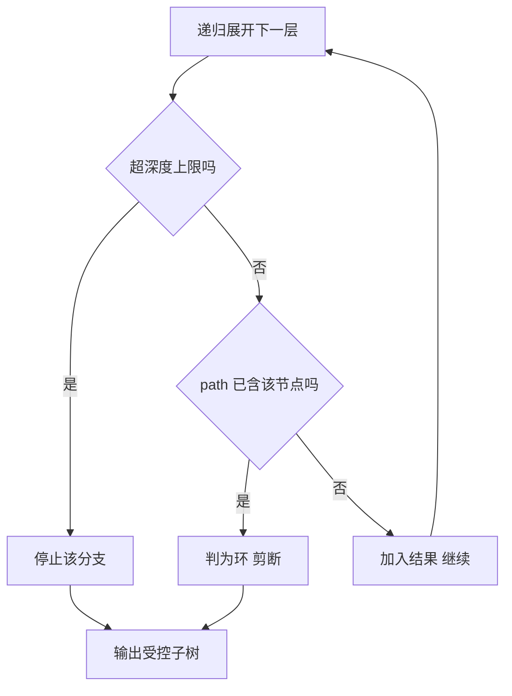

### Q2742 · 递归树的深度守卫: 层级上限与防环双保险

> 难度:★★★☆ | 标签:SQL, 递归CTE

**问**:递归 CTE 展开组织树,数据里万一有环怎么办?要不要限制深度?

**答**:要,而且要双保险。第一层保险是深度计数:锚点里带 depth=0,递归项里 depth+1,并用 WHERE depth < 上限 截断,上限取业务树的最大合理层级;第二层保险是路径防环:锚点携带 path 字符串,递归项用 path NOT LIKE 检查新节点是否已在路径里,在就剪断。深度上限挡的是"合法但过深"的数据拖垮查询,防环挡的是"脏数据成环"导致的无限递归——两者只留一个都不够。线上树形数据的成环几乎都来自脏更新,把守卫内置进查询,等于给最坏情况上了一个确定性的止损。



```python
# file: code/04_数据库与缓存/q2742_recursive_depth_guard.py
"""递归 CTE 的深度守卫: 层级上限与防环 path 检查双保险"""
import sqlite3

conn = sqlite3.connect(":memory:")
c = conn.cursor()
c.execute("CREATE TABLE node (id INTEGER PRIMARY KEY, parent INTEGER, name TEXT)")
c.executemany("INSERT INTO node VALUES(?,?,?)",
              [(1, None, "root"), (2, 1, "a"), (3, 2, "b"),
               (4, 3, "c"), (5, 4, "d"), (6, 3, "e")])

def subtree(root, max_depth):
    sql = """
    WITH RECURSIVE walk AS (
      SELECT id, parent, name, 0 AS depth, ',' || id || ',' AS path
      FROM node WHERE id = :root
      UNION ALL
      SELECT n.id, n.parent, n.name, w.depth + 1, w.path || n.id || ','
      FROM node n JOIN walk w ON n.parent = w.id
      WHERE w.depth < :max_depth AND w.path NOT LIKE '%,' || n.id || ',%'
    )
    SELECT id, name, depth FROM walk ORDER BY depth, id
    """
    return c.execute(sql, {"root": root, "max_depth": max_depth}).fetchall()

print("root=1 全量展开:", subtree(1, 6))
print("root=1 深度限制 2:", subtree(1, 2), "(超过两层的分支被截断)")

# 故意造环: 2 的父亲改成 5, 形成 2-3-4-5-2 的环, 无守卫的递归会无限转下去
c.execute("UPDATE node SET parent=5 WHERE id=2")
print("环数据 + 守卫 depth<3:", subtree(2, 3), "(守卫保证必停)")
```

**追问**:
- 不加守卫 SQLite 会自己停吗?—— 不会主动检测环,纯环数据会一直递归,必须靠查询里的守卫止损。
- 需要按层级展示每层聚合怎么办?—— 在外层对 walk 结果按 depth 再 GROUP BY,一次递归两用。

---
